<p align="center">
  <picture>
    <source media="(prefers-color-scheme: dark)" srcset="docs/readme/name-dark.svg">
    
  </picture>
</p>

<p align="center">
  <b>Every Claude Code session on your Mac, in one small panel that knows whose move it is.</b><br>
  Four sessions, in Claude Desktop and three terminal tabs, and one of them has been waiting on you for ten minutes.
  Whozmove floats over your windows and shows you which, so you can answer it right there.
</p>

<p align="center">
  <a href="#install"></a>
</p>

<picture><source media="(prefers-color-scheme: dark)" srcset="docs/readme/hero-dark.webp">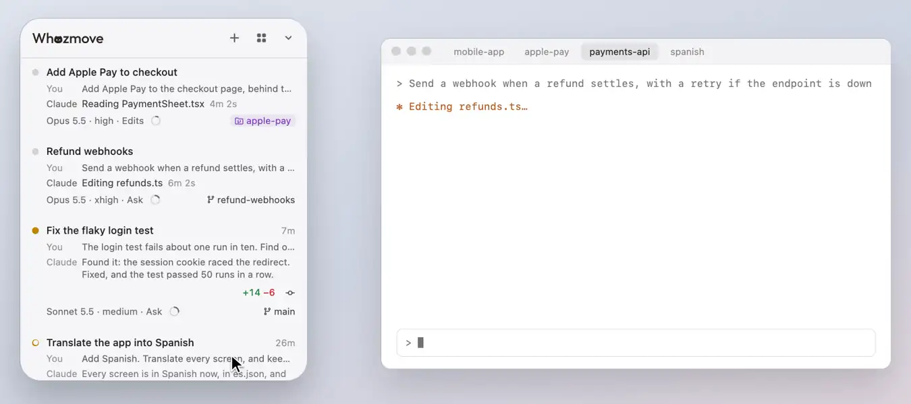</picture>

## Whose move it is, at a glance

<table>
  <tr>
    <td width="33%" valign="top"> <b>Needs you</b><br>A request or a question is waiting. Answer it on its row.</td>
    <td width="33%" valign="top"> <b>Your turn</b><br>Claude has replied and you haven't read it yet.</td>
    <td width="33%" valign="top"> <b>Working</b><br>Claude is at it, and its line says what it's doing, step by step.</td>
  </tr>
</table>

Newest first, like a chat app: whenever a message comes in, its conversation goes to the top. Press any row and you're
in that session, in Claude Desktop, Ghostty or iTerm2, with the keyboard ready to type.

## What it does for you

### It taps you on the shoulder

Fold the panel down to a small round glass. When a session needs you, its row comes out beside it, ready to answer
with a press. Point at it and the whole list opens.

<picture><source media="(prefers-color-scheme: dark)" srcset="docs/readme/folded-dark.webp">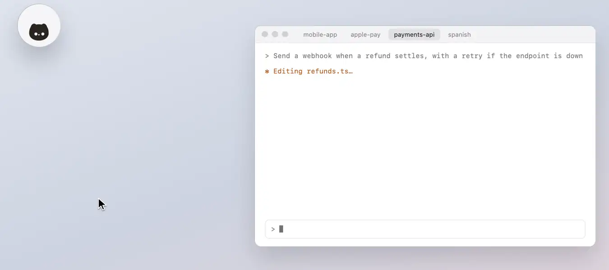</picture>

### Answer it where you are

Allow a command once or deny it, and answer Claude's questions, right on the row. Claude's own prompt keeps working
too: whichever you answer first counts.

<picture><source media="(prefers-color-scheme: dark)" srcset="docs/readme/requests-dark.webp">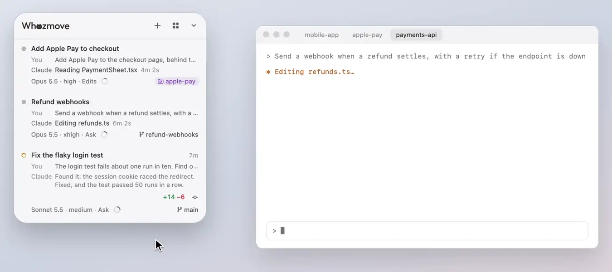</picture>

### Start the next one, in a worktree of its own

Press <kbd>⌃⌥N</kbd> in any app, say what Claude should do, and press <kbd>⌘Return</kbd>. Type <b>@</b> for another
project and <b>#</b> for a branch: a new one gets a worktree of its own, so two agents never trip over each other.

<picture><source media="(prefers-color-scheme: dark)" srcset="docs/readme/start-dark.webp">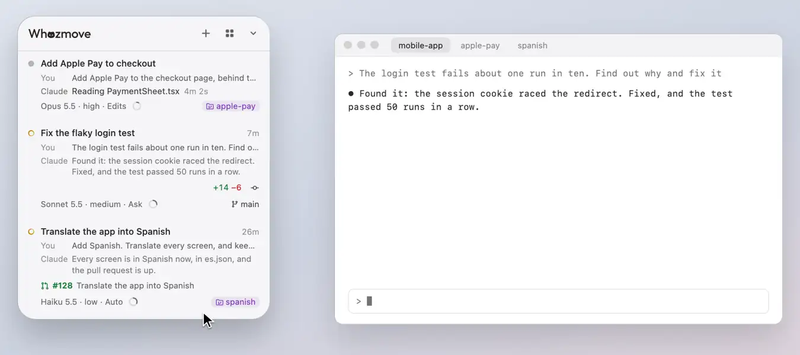</picture>

### See what changed, and commit it

A row's green and red numbers are what isn't committed yet. Press them and the panel opens beside the list with every
changed line, the way `git status` splits them; press Commit and Claude commits. After a code review, the row says how
it went: "Reviewed · all fixed".

<picture><source media="(prefers-color-scheme: dark)" srcset="docs/readme/changes-dark.webp">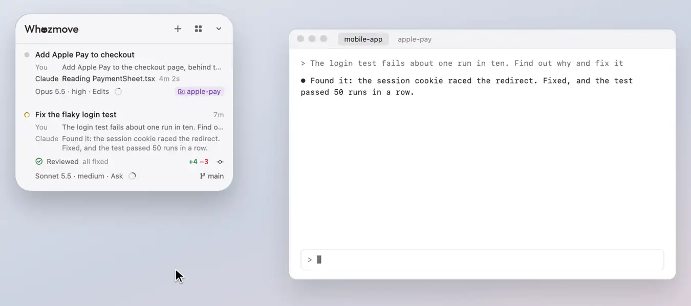</picture>

### Read the plan, try the prototype

What a session wrote for you opens beside the list: the pages it made, working as they would in a browser, its plans
and its notes. Send a plan back with your notes, or stop it.

<picture><source media="(prefers-color-scheme: dark)" srcset="docs/readme/notes-dark.webp">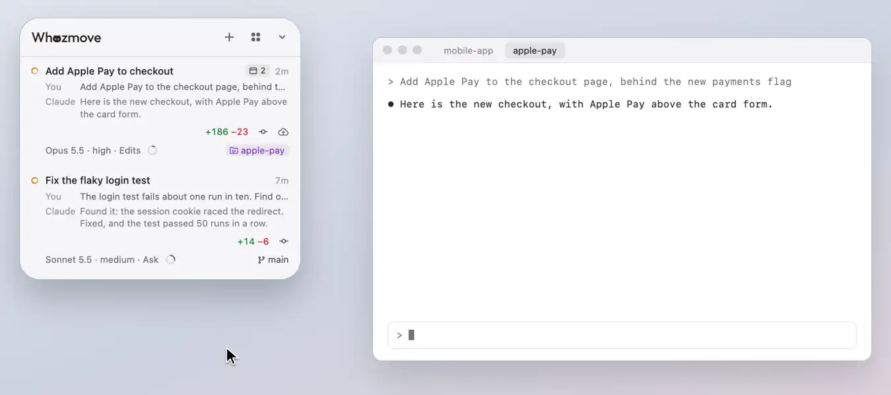</picture>

### Model, effort and mode, from the row

Change a session's model, effort or mode while it sits idle. A ring shows how full its conversation is, says when
it's a good time to compact, and compacts it from there.

<picture><source media="(prefers-color-scheme: dark)" srcset="docs/readme/model-dark.webp">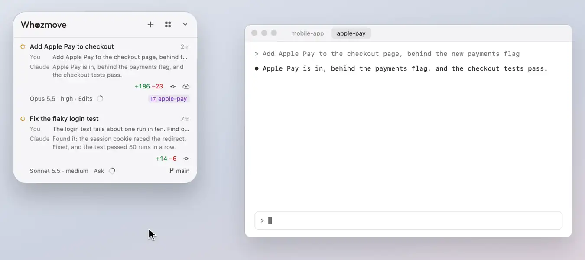</picture>

### Deploy with one press

Your project's own command, run on your Mac from the row, and never while an agent is in the middle of a change.

<picture><source media="(prefers-color-scheme: dark)" srcset="docs/readme/deploy-dark.webp">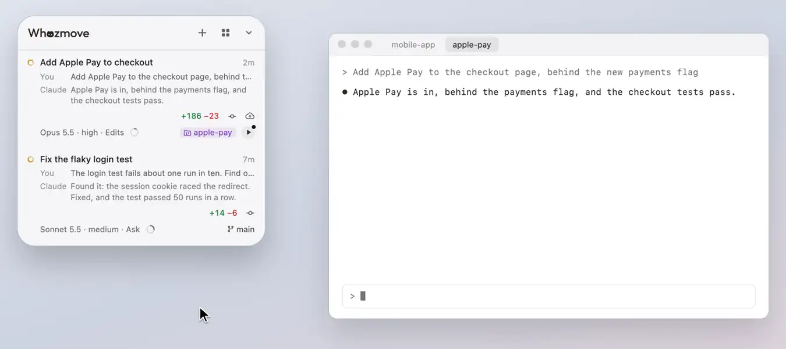</picture>

### Pick up where you left off

Closed the tab, quit the terminal, restarted the Mac? The conversation stays listed. Press it and it carries on, in a
new tab of the terminal it ran in.

<picture><source media="(prefers-color-scheme: dark)" srcset="docs/readme/restore-dark.webp">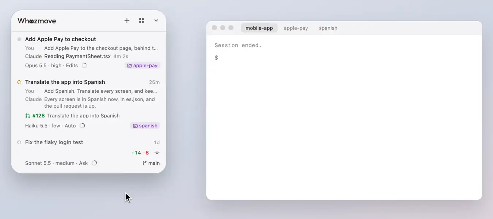</picture>

### Know what's left of your plan

Your session and your week, as Claude's own Usage page has them, on a card that tucks away under the panel and slides
out when you point at it.

<picture><source media="(prefers-color-scheme: dark)" srcset="docs/readme/usage-dark.webp"></picture>

### Your music, and its words

Press Spotify's round token at the panel's corner and the song plays in a strip under the list, its words lit line by
line as they're sung.

<picture><source media="(prefers-color-scheme: dark)" srcset="docs/readme/spotify-dark.webp">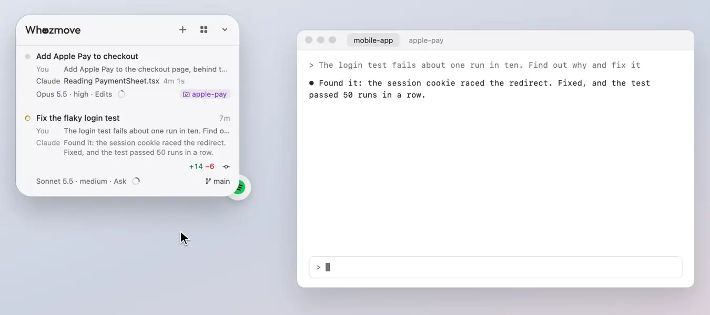</picture>

<p align="center"><a href="docs/using/README.md"><b>Every part of the panel, in detail</b></a></p>

## Install

```bash
brew install --cask whozmove/tap/whozmove
```

Then open it. Whozmove sets itself up: it adds its hooks to Claude Code and opens at every login, and it says when a
new version is out for `brew upgrade`.

> [!NOTE]
> macOS asks for two permissions when they're first needed: **Accessibility**, to use Claude Desktop's message box
> and buttons, and **Automation**, to switch to and type into Ghostty and iTerm2 tabs and to control Spotify.
> Storage's map asks for **Full Disk Access** only once it's missing folders for want of it.

<table>
  <tr>
    <td width="50%" valign="top"><b>You need</b><br>A Mac with Apple silicon and macOS 15 or later, Claude Code or
      Claude Desktop, and Apple's command line developer tools (Whozmove asks for them if they're missing)</td>
    <td width="50%" valign="top"><b>It works with</b><br>Claude Desktop, Ghostty and iTerm2 (sessions in other terminals are listed too),
      <code>gh</code> for pull requests, and Spotify</td>
  </tr>
</table>

<details>
<summary><b>From source, uninstalling, and what it's tested with</b></summary>

From source:

```bash
git clone https://github.com/whozmove/whozmove
cd whozmove
./install.sh
```

To take it out, with its login item, its folder and its hooks:

```bash
brew uninstall --cask --zap whozmove
claude plugin uninstall whozmove@whozmove
claude plugin marketplace remove whozmove
```

Installed from source, `./install.sh --uninstall` does the same.

Whozmove reads files and labels the apps it works with don't document, so an update to one of them can break part
of the panel until Whozmove catches up. The versions it's tested with, and everything else about installing, the setup
line, its hooks and Open at Login, are in [Installing](docs/using/install.md).

</details>

## How it works

<picture>
  <source media="(prefers-color-scheme: dark)" srcset="docs/readme/how-it-works-dark.svg">
  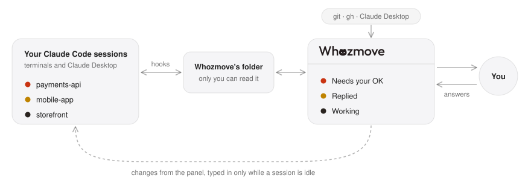
</picture>

Claude Code's hooks note what each session is doing and leave its requests for the panel; Whozmove reads them, with
Claude Desktop's own files and git, and sends your answers back the same way. Piece by piece, in
[How it works](docs/how-it-works/overview.md) and [Where it reads from](docs/how-it-works/where-it-reads.md).

## Privacy

<table>
  <tr>
    <td width="33%" align="center" valign="top"><br><b>It stays on your Mac</b><br><sub>Only <code>gh</code> asking GitHub about your pull requests, their authors' avatars, Claude Code asking Anthropic for your plan's usage or a question you ask on a session's side, Spotify's song covers, lyrics if you turn them on, Jira once you sign in with Atlassian, a look for a new version, and what a prototype a session wrote loads from the web as you try it go out.</sub></td>
    <td width="33%" align="center" valign="top"><br><b>Only you can read it</b><br><sub>Its folder keeps each session's last message and reply, what it found in each session's transcript, what you ask a session about a task or in its side chat, and a small log, for your eyes only.</sub></td>
    <td width="33%" align="center" valign="top"><br><b>It allows once, never always</b><br><sub>And it types into a session only while it sits idle at its prompt, with nothing waiting. Held keys only bring one forward.</sub></td>
  </tr>
</table>

<details>
<summary><b>All of it, in detail</b></summary>

- The panel's only network traffic is `gh` asking GitHub about your PRs (as you, through your signed-in `gh`)
  and the GitHub avatars on PR cards, and Claude Code's own `claude` command asking Anthropic for your plan's usage
  (as you, through its own sign-in: Whozmove never reads your login, and keeps only the numbers, the last percents
  and reset times in its folder, `usage-last.json`, for a script of yours to read; and for your gear, those numbers
  over 3 days with the hours your sessions worked, `usage-gear.json`, and your gear, the number working and the
  recommended one, `gear.json`, for a chief session of yours), and, when you press Ask Without Interrupting, Claude
  Code's own `claude` sending a copy of that session's conversation and your question to Anthropic, as the session
  itself does, with the files it reads in the session's folder and what git shows there (never a line of a file where
  keys are kept, whether read, searched or shown by git), and your earlier side
  questions and their answers again when a fresh copy is asked, and
  the cover of the song Spotify is playing, from Spotify's image server, at the address Spotify gives; and, once
  you've said yes to lyrics, LRCLIB (lrclib.net), told each song's name, artist, album and length to find its lyrics;
  and, installed with Homebrew, GitHub asked for the tap's cask file (raw.githubusercontent.com) as it opens and
  every 6 hours, to see whether a new version is out, with no sign-in and nothing of yours in the request; and a
  page or prototype a session wrote, opened in the reader, loads the scripts, fonts, pictures and frames it names from
  the web, as it would in a browser; and, once
  you sign in with Atlassian, Atlassian's server for AI tools (mcp.atlassian.com, signing in at auth.atlassian.com),
  as you: the words you search for on the new conversation card, a ticket's key or link you paste there, the tickets
  you give conversations, read with their next steps, boards and description, each move of one, by your Move It or by a
  conversation you let move its ticket, with its note and the fields its step sets, and a new ticket a conversation
  drafted: the project it goes in, to check the types it takes, then its title, type, description, priority and parent
  once you press Create Ticket, none of which is kept or logged; for each ticket's project, its priorities in
  their order, read with the ticket and kept in memory only, for an hour; and when you give a new conversation a
  ticket in a project whose way of opening tickets isn't set yet, the fields that ticket's type takes one option of,
  with their options, kept in memory only, for an hour, and the ticket's own options; and when a conversation in a project where
  one has worked one of your tickets, or that you've turned reading on for, asks Whozmove for your tickets, every ticket you
  can see, the most recently changed first, with who reported each and who it's
  assigned to, their labels, links and when they changed, and one ticket's history of moves when it asks, held in
  memory only until that conversation is told, ten minutes at most, and never logged; other Jira tools in Claude Code or
  Claude Desktop read with their own sign-in, never through Whozmove. Signing in registers Whozmove there, named
  Whozmove, with a return address on this Mac (127.0.0.1) that only that sign-in uses. Everything else stays on this
  Mac.
- Deploy runs only the command you confirmed for a project, in your own shell; and, when you press Install and
  Deploy on its card, once, the install your checkout's lock file names (`npm ci` and the like), which fetches
  packages from wherever your package manager does.
- Jira's sign-in (its refresh token and the id Whozmove registered with) stays in this Mac's Keychain, with the scopes
  it asked for and which build of Whozmove kept it, where macOS gives it only to that build, and Whozmove never uses an
  entry other apps can read, or one changed since: an updated Whozmove asks once, after your press of Allow. Its
  access token is kept in memory only, and none of them is ever written to a file or a log. Which ticket each
  conversation works on (its tracker, site and key, with that conversation's process) is kept in Whozmove's folder,
  `tickets/`, only to offer it back after Whozmove starts again; a ticket's words are never kept or logged. Its
  description goes to the conversation working on it, when that conversation asks for its ticket, or to a
  conversation that reads that ticket whole, and that conversation sends it to Anthropic as part of the conversation,
  as a session does with anything it reads, as it does with the tickets it reads, the names and account ids on them
  included. Whozmove
  itself holds it in memory only, never in a file or a log. Where each project's tickets open is kept in
  `ticket-routing/`: the project's folder, and for a way by a field, its tracker and site, the field's and its
  options' ids and names, and each option's folder. Which projects read your tickets (those where a conversation has
  worked one of your tickets, and those you've turned reading on or off for) are kept in `ticket-reading.json`, by
  their folders.
- How a project works, as a session drafted it, is kept only once you press Keep It on its row: the project's folder,
  the note and when you kept it, in Whozmove's folder, `process-notes/`. What you said Not Now to is kept only in
  memory. The note goes nowhere, and the log never holds a word of it.
- While a session waits on its pull request, `gh` asks GitHub for that pull request's comments and reviews once a
  minute: who wrote each, whether GitHub says they can change the repo, and when, are read to know whether to wake
  it, and only who and when are kept, in memory. What each waiting session waits on (when its wait began, its
  process, whether its conversation has closed, and its pull request's address) is kept in Whozmove's folder, `waits/`,
  so a restart finds it; never a word of a comment. A closed one's terminal record notes that it waits, so its row
  stays listed for up to 30 days; and Resume's fixed words for it are kept in `reopen/` only until its new tab has
  read them.
- To turn Spotify down while you talk to a session, it asks macOS which app is using a microphone, never for the
  sound, and needs no microphone permission for it.
- What it keeps is in `~/Library/Application Support/Whozmove/`, which only you can read: each session's last message
  and Claude's last reply (their first 280 characters), what it's doing at the moment (a command, a file's name, a
  search) and how far each turn took the work, what it still runs in the background (each job's description, a
  command's command line, when it started, and where the conversation's transcript is, beside which Whozmove reads
  Claude Code's own record of each agent to see when it has finished), what it found in each session's transcript, so
  it needn't read it all again when it opens (its pull requests, the paths of the files it edited with a number for
  each line it changed, the titles and places of what it wrote for you, a page's address without a name, password or
  query, its context, and what it used today), while the session is listed and never with anything in it shaped like a
  key, a request from a session started before this version while it waits for your OK (a newer session's comes to the
  panel over a line of its own and is kept only in memory), the switches you've turned on at the foot of a session's
  mode menu (Don't Wait on Me, with since when; Let It Deploy, with that session's process and the project's folder and
  command it was allowed; and which of May Send Back Plans, May Answer Questions and May Approve Plans you've ticked for
  which folder, only the folder, the switch and when a session there last held it, so one press can bring them back
  after an update or a Quit, and they lapse after 7 days unused),
  the deploy command you've confirmed for each project, with a fingerprint of all it runs and
  the port each checkout's build gets (reading which ports its own runs listen on, and as you press Deploy, which
  program holds the port it needs), each deploy's log and the commit the last one put in place, the words of a
  conversation you start in a terminal until it has started, the lyrics found for the last 1,000 songs you played, until
  you turn lyrics off, where the app runs from and when its hooks first went into Claude Code, a new version you've
  hidden from the line under the header, what else you've put away from that line and until when, what of each session
  has already come out beside the folded panel and when (so a restart doesn't bring it out again), the tasks a session hands you
  to do, when you last read each, and your answers to them (with what you typed), and the last ten things you asked
  about each, until that
  session's process ends, what you send a session in its side chat and how far each got, until its process ends, the
  messages your sessions write to a team's lead's inbox, with how pressing each is and when it was read and answered,
  for up to two weeks (never one with anything in it shaped like a key), your
  disk's free space each hour for two weeks, what you turn to while Working on Whozmove ▸ Keep App Switches is
  ticked, for two weeks (each app coming to the front, only as one Whozmove works with or another, never which; going
  away from the Mac and back; each session you look at, by its id), the map of your disk (the name and size of anything of 1 MB or more, each
  checkout and each folder it can't look inside) while Storage is on, what Keys found (each key's kind, how keys of its
  kind start and its last 4 characters, where it is, what its line says it's set as or for, a sign-in token's end date,
  and a fingerprint made with a secret only this Mac has, never the key itself), where each conversation you moved to
  the Trash from Sessions went (its title, its project's folder and its files' places, never what it says) until you
  empty the Trash, the team file a session leading a team for you writes there, which Whozmove only reads, and only
  while Show Teams is ticked, for the team's groups in the list, its board and One Task, and which sessions its lead may
  answer for, and a small log, which can hold folder paths, repository and conversation names, and text typed into
  sessions. A
  new tab in iTerm2 runs from a file of commands in your own temporary folder, which only you can read and which removes
  itself as it runs. A command macOS's Terminal runs (Sign in, or a conversation carried on there) is a file of commands
  in Whozmove's folder, taken away as it starts.
- Keys reads your projects and their commits, what Claude Code, Codex, Gemini CLI and Aider keep of your
  conversations, what Claude Code reads into every session as its instructions (your CLAUDE.md files, rules, skills,
  agents, commands and output styles, each project's memory, and what they import), your shell history and your
  shell's settings (`~/.zshrc`, `~/.bashrc` and the rest), Whozmove's own records and, with Full Disk Access,
  Downloads; and who can read your credential files, never what's in them, but for whether Docker's settings hold a
  sign-in at all. It looks with the Betterleaks the app carries, offline, and checks no
  key with anyone. The only file it changes outside its own folder is Whozmove's record of a session, where it masks a
  key at once; anything else changes only when you press its fix.
- Sessions, on the panel's back, reads which conversations Claude Code keeps (their folder, title and when they last
  moved) and which of them Claude Desktop keeps, even while its sessions aren't tracked, never what they say. It moves
  a conversation's files only to the Trash, never deletes them, and only when you press Move to Trash; one still open
  is ended first, its process told to quit as closing its tab would.
- The hooks go into Claude Code through its own `claude plugin` commands, which record them in its settings
  (`~/.claude/settings.json`): Whozmove itself doesn't edit that file for them. They record nothing once Whozmove is
  gone, only while the app noted in its folder is there.
- Trusting a folder on the new conversation card records exactly that, the one key for that folder
  (`hasTrustDialogAccepted`), in Claude Code's `~/.claude.json`, where Claude Code and Claude Desktop both look, under
  the same lock Claude Code takes to write it. Nothing else in that file is changed, and only that key is ever read
  from it; it's never logged.
- The permission hook only ever allows once, never "always allow", and never approves a plan, and keys go into a terminal session only
  while it sits idle at its prompt, with no request waiting. The one exception is a single Backspace: when
  Whozmove sends a next step's request into a session, it first sets aside anything you'd typed there, with an "x"
  typed before it (else Claude Code would bring back an older draft), and once Claude Code has put your text back,
  that Backspace takes the "x" out, while Claude has already started on the request. Never while Claude asks
  something or a request waits.
- With Bring Forward on, Whozmove looks 20 times a second at which modifier keys are held and at how many keys have been
  pressed, never at which, and holds up, changes or posts none. Holding its keys brings the session you picked forward
  and types nothing: your dictation app types into it once it's in front.
- Releases are signed with their developer's Developer ID, notarised by Apple and built on GitHub from their
  version's tagged commit (`tools/release.sh`, run by `.github/workflows/release.yml`), so the permissions you give
  Whozmove are kept for its developer's signature: every update keeps them, and an app signed by anyone else doesn't
  get them. `build.sh` signs a build of your own with your Developer ID once you've set one up
  ([Signing your own builds](docs/guides/signing.md)), and otherwise ad hoc, with its bundle id as its identity, so
  a rebuild keeps the permissions there too, though any other app signed ad hoc as `com.whozmove.app` would get them
  as well, which your own Developer ID closes. Every program in the app runs with macOS's hardened runtime.

</details>

To report a security problem, follow [SECURITY.md](SECURITY.md) rather than opening a public issue.

Whozmove is an independent project. It isn't made by, affiliated with or endorsed by Anthropic.

## Follow along

[hello@whozmove.com](mailto:hello@whozmove.com)

## Contributing and licence

How it's built and how to work on it is in [CONTRIBUTING.md](CONTRIBUTING.md), and everyone taking part follows the
[code of conduct](CODE_OF_CONDUCT.md). What changed in each release is in [CHANGELOG.md](CHANGELOG.md).

Copyright (C) 2026 Satyaraj

Whozmove is free software under the [GNU General Public License](LICENSE), version 3 or (at your option)
any later version: you can use, study, change and share it, and anything you share that's built on it must
stay open under the same licence.

The pull-request and branch icons are GitHub's [Octicons](https://github.com/primer/octicons), under the MIT
licence (Copyright (c) 2026 GitHub Inc.); its full notice is beside them, in `panel/scripts/icons.js` and
`modules/git/page/prs.js`.

Keys looks with [Betterleaks](https://github.com/betterleaks/betterleaks), which every copy of Whozmove carries,
unchanged, under the MIT licence; its full notice is in the app, in `Contents/Resources/Betterleaks-LICENSE`.
