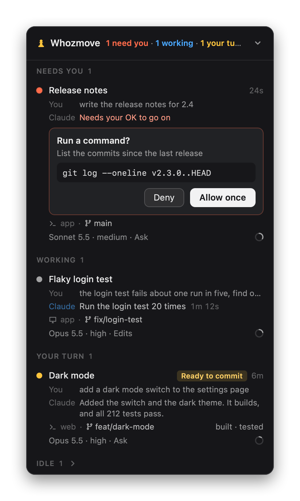

# Whozmove

A small Mac panel that floats above every window and tells you whose move it is: yours or your AI coding
agents'. It lists every Claude Code session running on this Mac, in Claude Desktop and in the terminal,
with what each is doing, so you can see at a glance which one needs you.

<p align="center"></p>

- group by **status** (Your turn / Working / Seen / Idle) or by **project**, with a ＋ per project that starts a new
  conversation there (⌥-click: in Ghostty)
- **Your turn** comes first: the sessions waiting on you, with a request or question (a pulsing red-orange dot) or a
  reply you haven't read (an amber dot), first come, first served. One that comes in joins the end, so nothing above
  it moves, and a reply waits there until you've read it. A reply you've read gets an empty amber dot and its row goes
  to **Seen**, below **Working**, then to **Idle** an hour after the last message, Claude's or yours. Opening a
  session here, being on it in Claude or Ghostty for a couple of seconds after it replied (watching the reply come in
  counts), or writing to it counts as reading its reply; for a session in another terminal, only opening it here or
  writing to it does. The header's line counts what the sections show ("2 your turn · 1 working", in red-orange while
  a request waits), or with neither, how many are in Seen and Idle
- **start a conversation** from the ＋ in the panel's header, or ⌃⌥N from any app: a card opens at the top of the
  panel, under the header; write what Claude should do and press ⌘Return (Return starts a new line). The card is
  shaped like the row it becomes.
  Chips under your words say where it starts: the project (that of the session you're on, at first) and, in a git
  repository, where in it; type **@** in your words, or press the project's chip, to choose another project (or any
  folder), and the line under the box says where it runs. The Start button shows the app it starts in, its icon and,
  once you've written something, its name, saying **Start in Claude** while you hold ⌘; the arrow beside it switches
  between Claude Desktop and Ghostty, and the next card starts with the one you chose last. Once started, the card turns
  into that row and moves down to its place in the list, where it says it's starting until Claude lists the
  conversation. A folder Claude hasn't worked in before is asked about on the
  card (**Trust and start**), so neither Claude Desktop nor Claude Code stops to ask again. In Claude Desktop your
  words go into the new conversation's message box, Whozmove chooses the folder's environment among the recent ones
  Claude lists (when Claude hasn't already) and presses Send once Claude shows it. This needs the Accessibility
  permission; without it, if the folder's environment isn't among Claude's recent ones, or if Claude doesn't take the
  press, your words wait there for you to choose it and send. If Claude starts it in another folder anyway, the row
  follows it there and says so. In Ghostty, a new tab runs `claude` with them.
  In a git repository, type **#** (or press the branch's chip) to choose where in it: its own folder, a worktree
  that's there, or a new worktree, a folder of its own, for a branch that's there or a new branch named from your
  words (**#name** names it, and **#name from release** starts it from that branch, else from the repo's main branch as
  this Mac has it, which it then follows). A new worktree is in the worktree colour, with the branch it starts from
  beside it; anything in a worktree starts in Ghostty. Nothing ever switches the branch of a folder in use: a branch
  is only checked out in a new folder. When another agent is at work in the project's folder, or changes there aren't
  committed, the card says so, with **Use a new worktree**. A new worktree goes in a folder beside the repo, named after
  it (`~/code/shop-worktrees` for `~/code/shop`), never inside it, or in a folder you choose from the line under the box,
  kept for that repo. Close a card before it starts and the next one comes back as you left it: your words, where it
  starts and the app
- Claude Desktop conversations stay listed after Claude quits (those active in the last 3 days)
- the session **you're on** is marked, and scrolled into view as you switch: the conversation open in Claude, or
  the session in the Ghostty tab you're looking at, whichever of the two apps you were in last
- a row you press (to open it, answer it, or run a step or Deploy) stays where it is, showing what it does there,
  until you've moved on from the panel: your pointer off it (and moved, when the panel shrank under it or one of its
  menus closed there) and none of its boxes typed in. Then it goes to its place
- the last exchange, as a chat: your message, and below it Claude's line. While Claude works, its "Claude"
  label fades in and out in blue and the line says what it's doing, timed from your message like Claude's own
  progress row: the command's description ("Run the tests"), "Reading app.ts", "Editing styles.css",
  "Searching the web: …", "Calendar: list events", and so on. As in Claude, the latest step stays up while
  Claude thinks, and the reply takes its place at the end. Both lines stay from turn to turn, so your
  message, each step and the reply change the text in place, and Claude shows thinking the moment you
  send. A step shows once it starts running: a hook can't see it while Claude is still writing it. A
  working session's dot fades on and off
- a ring for how full each session's context is. Pointed at, it widens into a **Compact** button, filled
  the same way. A click opens a card with how much is left before auto-compact ("427k left") and three ways
  to compact: Compact, Keep details and Keep essentials (the last two are `/compact` with instructions for
  what the summary keeps), or your own focus. It goes in like a model pick, while the session is idle.
  Claude's line says "Compacting the conversation" until it's done, and the ring drops to the new size
  straight away
- each session's model, effort and permission mode: click one to change it while the session sits idle.
  Never while it's working or asking you something, since a key typed into a permission prompt would
  answer it.
  - In Ghostty, the panel types `/model …` or `/effort …` into the session's tab (a half-typed draft is
    stashed and comes back), or presses Shift+Tab for the mode. Those commands also save your choice as the
    default for new sessions, so the panel puts your default back (only that setting, and only when the
    command says it saved it). The mode menu offers only the modes it can reach with a known number of
    presses. Auto isn't in every session's Shift+Tab cycle, so unless the session is in Auto now or your
    settings turn Auto off, the menu offers just the moves that are the same either way, and says to change
    the others in the terminal. If Claude Code asks to confirm (switching model on a cached conversation),
    the tab comes forward.
  - In Claude Desktop, the same slash command goes into the conversation's own message box and is sent
    with its Send button through the Accessibility API, so nothing is typed and no menus open. Return is
    pressed only if Claude shows no Send button, and only while Claude is in front. Claude switches to the
    conversation first if it isn't showing it. The mode menu offers only Plan, since `/plan` is the only
    slash command for a mode, and nothing is sent while you have a message half-written there. Claude's
    "Switch model?" (a model switch re-reads a cached conversation) is asked in the panel instead, and your
    answer goes to Claude's box. This needs the Accessibility permission for Whozmove
- the **island**, a glass capsule under the row's project and branch line while the session's checkout has work in
  flight, with a stage for each place the work can be: the files changed, the checkout's **extra stage** if it has
  one (below), the commits not on GitHub yet, and GitHub (the branch's pull request, or "no PR" for a branch pushed
  without one). A stage holding something shows its count, an empty one is a dot, and the one where your next move is
  is brighter; in git checkouts only
  - The files stage is a gauge, filled as far as its files are staged. Pointing at it opens it into three parts, each
    file counted once: **staged**, **partly** (staged, then changed again: a commit now takes the staged version, and
    the later changes stay behind) and **unstaged** (new files included). The island's other stages shrink to dots
    meanwhile, to make room. Pointing at a part shows its files, the first 100, in a list that grows out of the
    pointer and follows it along the gauge; you can move into the list to scroll it
  - Pointing at the commits stage shows its menu as a card: the commits not on GitHub yet and their steps. A click on
    it opens what those commits changed, file by file, beside the list. A click on another stage opens its menu: what it holds (files, the extra stage's own list) and its
    steps, while it holds something: Commit (and push, or open a pull request), Push, Create PR or Create Draft PR,
    Open PR #N. A step asks the session's agent in words ("Commit the changes."), the way a model pick goes in, only
    while that agent is idle and no other agent is working in that checkout (there, or editing files there; one
    waiting on you doesn't count). Meanwhile the island and its menus stay up, to show where the work stands, with
    the steps greyed out and a line saying which session they wait for. The line under the details says it's
    asking, or why it can't go in. "no PR" shows once GitHub has said the branch has none, so it needs `gh`
- an **extra stage** on the island for a checkout whose own git config names a command for one (`git config
  whozmove.stage '<command>'`): a tool that keeps changes on their way to a commit, such as a review queue, can show
  what it holds there, with its own list and steps in that stage's menu. While it holds something, the files stage
  counts only the files outside it, and when the tool names them, its gauge splits and lists just those. Whozmove asks
  you once, on the row, before it runs the command, and again whenever the command changes. **Stop This Stage**, in
  its menu, stops running it; after **Not now**, the files stage's menu has **Ask About the Extra Stage Again**.
  [docs/reference/stages.md](docs/reference/stages.md) says how to write one
- **Deploy**, a round play button at the end of the title line, for any project Whozmove can work out a deploy
  command for (a Compose file, a pm2 file, a Makefile `install` target, a package's `deploy:local` script or its
  commands, a Rust or Go program, a Python package with scripts, Whozmove's own `./build.sh --now`). It puts that
  checkout's or folder's code in place on this Mac, so in a worktree it runs that worktree's code:
  - The first press shows the command it suggests, to change if you like, and asks you to confirm it twice. When
    you confirm, the card also shows what a package script or Makefile target in the command really runs, and says
    if that looks as if it could deploy to production (Whozmove never suggests one that does). The command is
    saved for that project (in Whozmove's folder, never in the project), and from then on the button is always
    there, for every checkout of the project, with a dot when an agent has edited files or built there since the
    last deploy (a turn that only commits, pushes or runs the tests doesn't count). Until then it's offered only
    after an agent changes something. Projects Whozmove can't work out a command for get no Deploy
  - A press runs the command at the top of the session's checkout (or in its folder, outside git), in your own
    shell as your terminal starts it (so with the PATH your `~/.zshrc` sets, and nothing else of the panel's), and
    never while that session's agent is working or asking you something, or another agent is working in that
    checkout: the button is dimmed then, and says which session it waits for. While it runs, the button shows a
    stop square in a slowly turning arc and the line under the details says what's running; a press then offers
    **Stop Deploy**, which ends it and everything it started, and its log. A check shows once
    it's done; if it didn't go through, the line says why. Deploy is for commands that finish
  - A right-click (or Control-click) on it shows the command, and offers Change Deploy Command…, Forget Deploy
    Command (back to being offered only after new work) and the last run's log; with only a suggestion, Set Up
    Deploy… and Not This Time

  One session speaks for each checkout, and only its row has the island and Deploy: of the sessions running in that
  checkout, the one that edited files there last, whatever it has done since, so several chats in one checkout don't
  all show the same island. Notes it wrote elsewhere don't count, and a row is always about the checkout its session
  runs in: one that edits files in another checkout doesn't take that checkout's island or Deploy (which wait while
  its agent works there). When no session there has edited it, the session you used last there speaks for it, one
  still running first, so work left in a checkout keeps its island. The pawn menu's **Next Steps ▸** turns the island
  and Deploy, or just Deploy, off
- what the session itself changed that isn't committed yet, at the end of that line ("+26 −13"), as git status sees
  it: its own lines, even when other sessions or you work in the same checkout. Once it's all committed, the numbers
  go. Each changed line is credited to whoever wrote it: the session whose edits put it there (its sub-agents'
  included), or whose shell command did, as Claude Code records what each command changes in auto mode. A line no
  session's record has is **Outside these sessions** (a change made by hand, by a session that has closed, or brought
  in by git). A short or repeated line (a blank line, a `return nil;` that's there twice) goes with the lines around
  it; alone, it's no one's, as its text can't tell whose it is. A session that ran a shell command Claude Code didn't
  record (it records them in auto mode, or in any mode once you've turned `bashEditDiffEnabled` on in your settings)
  could have changed any line, so what it changed isn't known: its row shows all sessions' numbers, dimmed, and its
  view only theirs, naming no one, and in that checkout no line is said to be outside these sessions, as it might be
  that session's. A shell command that ends in an error leaves no record of what it changed either, so while a session
  there has one, no line is said to be outside these sessions. Pointing at the numbers shows how they sit among
  everything not committed in the checkout: this session's share, the other sessions', and what's outside them.
  Pressing them grows the panel beside the list, as for what a session wrote (below), with the files the session
  changed (not staged first) and the changes themselves, as git shows them: only its own lines,
  in green and red (anyone else's lines in the same file show as the file has them). **All sessions** shows every
  change not committed in the checkout instead, each changed line's edge in the colour of whose it is. With nothing to
  show, it says **No changes to commit**. Files show one after another or one at a time, and lines inline or side by
  side, as you pick (kept for next time). The view keeps up while the agent works, and lines it has just written light
  up once. **Open in Editor** opens a file at its first changed line: the first time, it asks which editor (Visual
  Studio Code, Cursor, Zed, Xcode, Sublime Text or BBEdit, the ones on your Mac), and the pawn menu's **Open With ▸**
  changes it.
- a permission prompt waiting, which you can answer on the row, under Claude's line. A card shows exactly
  what the agent wants to do (the command, and whether it would run in the background or outside the
  sandbox; for an edit, the lines it takes out and puts in; the whole of a file being written; the URL and
  what's asked of it; any other tool's input field by field, as Claude's own prompt lists it), with **Deny**
  and **Allow once**, never "always allow". Each part shows up to 100,000 characters; past that the card
  says the content is too large to show in full, and Allow once still allows all of it. Claude's own prompt
  stays usable too, and whichever you answer first counts. Sub-agents' requests and sessions that aren't
  interactive (`claude -p`) are left to Claude's own prompt
- what a session wrote for you to read, on a tag on its row (**Plan +2**): press it and the panel grows beside the
  list, which stays where it was, to fit what's shown (up to the screen's edges; a long plan scrolls), with the
  session's **Plans**, **Prototypes** (`.html` pages it created) and **Notes** (`.md` files it created) beside it,
  newest first. Drag it by either header to move it, reader and all. Plans and notes read as formatted text; a prototype
  runs as it would in a browser, without reaching anything else. A plan Claude is waiting on can be sent back with
  your notes (**Revise…**: Claude stays in plan mode and writes a new version) or stopped; approving it happens in the
  session, where **Take me there** brings you, as Claude Code takes a plan's approval only from its own prompt. ✕
  (or the tag again) folds the panel back to the list, where the list is now
- Claude's questions (its question tool) answered on the row, one at a time like Claude's own box: pick an
  option (or several), type your own answer, or enter a number, then Skip, Next, Submit, or × to dismiss
- the session's **branch**, in purple with a worktree icon when it runs in a worktree
- **open PRs** the session created or worked on, with a hover card (state, author, `+/−`, files)
- click a session to jump to it: Claude Desktop opens it (launching Claude if needed), and Ghostty switches to
  its tab (and its split, in a tab with several)
- your Claude plan's **usage**, at the bottom of the panel: the same numbers as Claude's own Usage page, for the
  session (five hours) and the week, each with how long until it resets ("2h 59m"; point at it for the clock time),
  coloured as Claude colours them for how close you are, and a note when you're on course to run out before the
  reset. Its handle (along its top edge, when pointed at) folds it into one row, `Session 40% 3h … Week 10%`, and a
  click on that row opens it again; folded to its header, the panel shows the session as a line under the header.
  While the session limit is reached, a vine grows in from the panel's corner until it resets, then blooms, its
  leaves fly off, and its stem pulls taut into the session's bar, fills it green and drains as usage starts over.
  It needs the `claude` command signed in once: **Sign in** opens a terminal tab running `claude auth login`.
  Signed in with an API key, there's no plan to show, and no strip
- **Spotify**, from a round token tucked half under the panel's bottom corner, on the side facing the middle of the
  screen (it travels under the panel to the other corner as you drag the panel across). Bring the pointer near and it leans out
  to meet it; press **Play** and Spotify opens in the background if it's closed and plays what it last had. Paused
  a while, the token wears the song's cover with a ring for how far in it is, and resumes it. Without Spotify on this Mac it
  offers **Download**, Spotify's download page, and turns into Play by itself once Spotify is installed. Signed
  out, Spotify comes forward to sign in, and the music starts once you have. macOS asks once whether Whozmove may
  control Spotify, at the first Play or song
- **now playing**, above the usage strip, while a song plays: the cover, the song and artist, how far in it is (a thin
  line along the top) and the time. Point at it for back, pause and next, and press the line to jump; press the strip to
  bring Spotify forward (once lyrics are on, to read them). A new song rolls in place; paused, it greys and offers Play,
  and after 15 minutes it folds into the token; with the panel folded to its header, the token stands in for the strip.
  The pawn menu's **Spotify ▸** has **Open Spotify**, **Show Lyrics**, **Hide Side Icon** and **Remove Spotify** (the
  token and the strip go, and Whozmove leaves Spotify alone; **Add Spotify** brings them back). macOS's Allow stays in
  System Settings → Privacy & Security → Automation
- **lyrics**, once you say yes to the strip's question (or turn on **Show Lyrics**): while a line is sung, it takes the
  place of the song's name in the strip, rolling in as the singer starts it, and the name comes back between verses.
  Press the strip to read the whole song beside the list, the line being sung lit as it plays; press a line to jump
  there. Pressed before a song's lyrics are here, the strip says "Loading lyrics…" or "Lyrics not available" for a
  moment instead, and they open if they come meanwhile. At their foot, **Show lyrics in the strip**, turned off, keeps
  the strip on the song's name, and **Open Spotify** brings Spotify forward. They come from LRCLIB (lrclib.net), a free
  library of lyrics that says when each line is sung: a song it doesn't have keeps its name in the strip, words without
  timings show beside the list only, and when LRCLIB is busy, Whozmove asks again, a little later each time. A song
  you've played before shows its lyrics at once, as they're kept on this Mac
- a pawn in the menu bar with a count of sessions waiting on you; its menu switches the grouping, has **New
  Conversation** (⌃⌥N), and turns ⌃⌥N off for other apps (**Use ⌃⌥N in Any App**)
- for working on Whozmove itself, **Working on Whozmove ▸** in that menu, shown only while you hold ⌥ (Option) as
  you open it: **Show Build in Header** puts, under "Whozmove", which worktree (or branch) the running build came
  from and when it was built, with its folder and commit when you point at it; **Preview the Wait** plays the usage
  strip's wait and its reset in 20 seconds, without a limit to wait for

### Colours

A label's colour says whose move it is:

| Colour | Meaning | Labels |
|---|---|---|
| red-orange | blocked or broken: fix it | a request or question waiting |
| amber | your move: a routine next step | Your turn |
| blue | work underway | Working |

## Install

Needs macOS, Xcode Command Line Tools (`clang`, and the `python3` the hooks run on) and Claude Code.
Optional: `gh`, signed in, for PR status; Claude Desktop and Ghostty, for jumping to and controlling their
sessions; the `claude` command, signed in to a Claude plan, for your plan's usage (Claude Desktop's own copy will
do). Sessions in other terminals are listed too, but a click only brings their app forward (not the
exact tab), they aren't marked as the one you're on, and their model, effort and mode can't be changed from
the panel.

Tested with Claude Code 2.1.302 (and 2.1.299, Claude Desktop's own copy), Claude Desktop 2.42304.0, Ghostty
1.3.1 and Spotify 1.3.5, with lyrics from LRCLIB's API. Whozmove reads files and labels these apps don't document, Claude Desktop's conversation files and log above
all, and asks Claude Code for your plan's usage a way it doesn't document either, so an update to one of them can
break part of the panel until Whozmove catches up. The fix goes in the module of the app that changed
(`modules/claude-code/app/ClaudeCodeFacts.h`, `modules/claude-desktop/app/ClaudeDesktopFacts.h`,
`modules/ghostty/app/GhosttyFacts.h`, `modules/spotify/app/SpotifyFacts.h`, and for LRCLIB
`modules/spotify/app/LRCLIBFacts.h`).

```bash
git clone https://github.com/whozmove/whozmove
cd whozmove
./install.sh   # builds the app, adds Whozmove's hooks to Claude Code, and starts the app now and at every login
```

The hooks are how the panel learns your last prompt, Claude's last reply, requests for your OK and the tool
each agent is using. `install.sh` adds them as a Claude Code plugin, `whozmove`, with Claude Code's own
`claude plugin` commands, so there's nothing to edit in `~/.claude/settings.json`. Without the `claude`
command (Claude Desktop only, say), it prints the two `/plugin` lines to run in a session instead. Sessions
pick up hooks when they start, so they apply to sessions started (or restarted) after this.

macOS asks for two permissions the first time they're needed: **Accessibility** for Whozmove (to
change settings, compact, focus the message box and send a new conversation's first message in Claude Desktop), and
**Automation** of Ghostty (to switch to and type into its tabs, open new ones, and see which one you're looking at)
and of Spotify (to show its song's cover and control it, asked at the first Play or the first song it plays). Both
can be granted later in System Settings → Privacy & Security.

After changing anything in `app/`, `modules/`, `panel/`, `icon/` or the hooks, run `./build.sh` again in your
terminal. It puts the app in place and restarts it, with the hooks too once they're installed as the plugin (a hook
change reaches sessions started after that). Run inside Claude Code, by an agent or by you with `!`, it leaves the
hooks as they are, since every session you start would run them; and once you've set up Deploy for Whozmove in the
panel, it only compiles while the panel runs with Deploy's button showing, and Deploy on the session's row puts it in
place when you press it. Running `./install.sh` again updates the hooks too. `./install.sh --uninstall` removes the
app, its login item and the plugin, and asks before deleting Whozmove's folder.

## How it works

| Shows | Comes from |
|---|---|
| Running sessions and status | `~/.claude/sessions/<pid>.json`, Claude Code's live session registry |
| Claude Desktop conversations, running or not | `~/Library/Application Support/Claude/claude-code-sessions/*/*/local_*.json` |
| Conversation open in Claude | `setFocusedSession` lines in Claude's `main.log` (instant), else the newest `lastFocusedAt` |
| Session in the Ghostty tab you're looking at | Ghostty's Apple events, once a second while it's in front: the terminals in its front window's selected tab (and the one with the keyboard, when the tab is split), matched to sessions by their folder and tab title, the way a click finds a session's tab. While that can't tell which session it is, the mark stays where it was |
| Last prompt / reply / notice | `~/Library/Application Support/Whozmove/sessions/<id>.json`, written by the hook (the folder is yours only: 700) |
| Live line | the same file: the hook describes each tool call as it starts (a command's own description, the file, the query, …) |
| Your turn, Seen, Idle | Your turn: a request waiting, or a reply (from the hook) you haven't read, however long ago: not opened here since, nor looked at since in Claude or Ghostty (on it for 2 seconds or more with that app in front, while the screen is awake and unlocked and the keyboard or mouse was used in the last 5 minutes; and Claude's own `lastFocusedAt`), with nothing written to it since. Seen: a reply you've read. Idle: no reply yet, or one you've read with nothing since for an hour, the transcript's newest message included |
| Permission requests | `~/Library/Application Support/Whozmove/asks/<id>.json`, left by the permission hook while it waits; your answer goes back in `<id>.answer.json` |
| Branch and worktree | the session folder's `.git`, read directly (no `git` process) |
| Changing model, effort, mode | Ghostty's AppleScript (`input text`, `send key`, `perform action "text:\x13"` for Ctrl+S); Claude Desktop's message box ("Prompt") and Submit button via the Accessibility API; the result from the transcript's `<local-command-stdout>` or Claude's conversation file |
| PRs | `pr-link` entries in the session transcript; open/merged state from `gh pr view` |
| The island and its counts | `git status` (which files are staged, partly staged or not), and per checkout `git merge-base` with its base branch (`origin/HEAD`'s, else `main` or `master`), `git diff --numstat` from there, new files' lines, and `git log` for the commits not on GitHub; the PRs from `gh` |
| What a session changed | the edits each session's transcript records (Edit, MultiEdit and Write, with the lines each put in and took out; what Claude Code recorded each shell command changed; the mode each command ran in), `bashEditDiffEnabled` in the machine's, the project's and your Claude Code settings, and per checkout, every 3 seconds at most while something there changes, `git diff` from the last commit, which files have changes not staged, and new files; and, while there are commits not on GitHub yet, what they changed; each changed line goes to whoever's edits match it |
| Extra stage | the command the checkout's own git config names (`whozmove.stage`), run only once you've allowed it, which you answer in the panel and Whozmove keeps in `~/Library/Application Support/Whozmove/stages.json` (see [docs/reference/stages.md](docs/reference/stages.md)) |
| Deploy | each project's command, which you confirm in the panel, and each folder's last deploy, in `~/Library/Application Support/Whozmove/deploy.json`; each run's log, exit status and whether you stopped it in `deploys/`; suggestions from the project's own files; when an agent last edited files or built, from the hook (`editedAt`, `builtAt`) |
| The running build | `build.json`, which `build.sh` writes inside the app |
| Now playing | what Spotify tells the whole Mac each time the song or its state changes (`com.spotify.client.PlaybackStateChanged`); the cover and the controls through Apple events to Spotify, only while it's running; Spotify is opened only when you press its token's Play |
| Lyrics | once you've said yes, LRCLIB (`lrclib.net/api/get`, then `/api/search`), asked about each song once it has played a moment, one request at a time, with its name, artist, album and length, then without the album, with its name tidied of what Spotify adds to say which version it is, and by its name and artist (only that, for a song over an hour); asked again when LRCLIB is busy, never sooner than it says; what it finds is kept in `~/Library/Application Support/Whozmove/lyrics/`, for the last 1,000 songs (a song without timed lyrics for a week, then it's asked about again); and while a song's lines follow it, where it is, asked of Spotify every 5 seconds |
| Plan usage | Claude Code itself: every 3 minutes (and just after a reset) Whozmove runs `claude` for a second, with nothing of yours loaded and nothing saved (`--safe-mode --no-session-persistence`), and asks it what its own `/usage` shows (its `get_usage` request); Claude Code signs in and asks Anthropic. When it has no plan to report, `claude auth status` says whether it's signed in |
| New conversations | in Ghostty, a new tab running `claude --session-id <id>` (an id the panel chooses, so the conversation's row is known from the start), with your words read from a file in Whozmove's folder rather than typed; in Claude Desktop, its `claude://code/new?q=…` link (without `folder=`, which Claude loses), then the environment its button beside Send names, the recent environments its page lists (which is which folder from its `ccd-session-presets.json`, only read) and its Send button via the Accessibility API (on its older screen, its folder button and its folder list's Recent folders, by path), and which conversation it started and where from the `LocalSessions.start:` and `Starting local session <id> in <folder>` lines in its `main.log`; whether Claude may work in the folder, from `projects[<folder>].hasTrustDialogAccepted` in Claude Code's `~/.claude.json` |

| File | Role |
|---|---|
| `app/` | the native app's core, one file per job (`core/`: the floating `NSPanel`, the menu bar item, the bridge to the page, the rows, the session you're on, and words typed into a session or sent to Claude Desktop), what modules fill in (`contracts/`) and the helpers that know no app (`shared/`) |
| `modules/` | one folder per module, each with its native code, its page files, its tests and a README: `claude-code/` (Claude Code's sessions, transcripts, details, requests, prompt and usage, and its hooks plugin); the apps sessions run in, `claude-desktop/` (Claude Desktop's conversations, its message box and new conversations), `ghostty/` (sessions' tabs in Ghostty, and typing into them) and `terminal-app/` (macOS's Terminal, for Sign in); and the features, `island/` (each row's checkout, its stages and their menus, and its PRs), `deploy/`, `changes/` (a session's numbers and the changes view), `reader/`, `usage/` (the usage strip), `starts/` (new conversations and ⌃⌥N), `commands/` (the model, effort and mode menus and the Compact card) and `spotify/` (the now-playing strip, its lyrics and Spotify's token) |
| `tools/` | `compile.sh`, the one compile line (build.sh, the tests, CI), and `page.sh`, which puts the page together with each module's page files |
| `panel/` | the UI's core, rendered in a transparent `WKWebView`: `panel.html` (the markup), `styles/` (`tokens.css`: its colours, text sizes and corners, each named for its job), and `scripts/`, one job each (rows and their places for each feature's parts, animation, hover, presses and typing, the reader; `whose-move.js`: what each session is, where its row goes, and which session speaks for each checkout; `modules.js`: what the modules plug into the page with); each feature's scripts, and its own styles, are in its module |
| `modules/claude-code/plugin/hooks/whozmove-claude.py` | Claude Code hook that records per-session context |
| `modules/claude-code/plugin/hooks/whozmove-claude-permission.py` | Claude Code PermissionRequest hook: asks in the panel as well as in Claude |
| `modules/claude-code/plugin/` (`hooks/hooks.json`, `.claude-plugin/`) | the Claude Code plugin that runs both hooks; `install.sh` adds it from a copy in Whozmove's folder |
| `icon/make-icon.m` | draws `icon/AppIcon.icns` (re-run only to change the icon) |
| `build.sh`, `install.sh`, `app/login-item.plist` | build, and install (the plugin and the login item); they read the app's name and id from `app/Info.plist` |
| `app/swap-in.sh`, `modules/claude-code/plugin.sh` | what puts a build of Whozmove and its hooks in place and restarts the app (every build carries a copy), and the plugin's copy with a version named after its hooks |
| `tests/` | `all.sh` runs every test: `rows.sh` checks the rows the app builds for a sample home folder, when keys may go into each session, its mode menus' Shift+Tab counts, the keys a command is typed with, what its menus say about why nothing can go in, how a command's result is read, what the usage strip gets from Claude Code's recorded answers, what a new conversation's start runs and how folder trust is read and recorded, and that this README names the macOS permissions the app asks for and no file names one it doesn't, `panel.sh` the page's labels, colours and row HTML, the usage strip's numbers and the vine's reset frame by frame, `build.sh` when a build only compiles and when it goes straight in, against a throwaway home folder, `checks.sh` that the modules stay apart; each compares with its recorded `.expected.txt`, and each module's own tests run too (Claude Code's run both hooks against a throwaway home folder) |
| `CONTRIBUTING.md` | how it's built and how to work on it |
| `CHANGELOG.md` | what changed in each release |
| `SECURITY.md` | how to report a security problem, and what happens next |
| `CODE_OF_CONDUCT.md` | how everyone taking part treats each other, and how to report a problem (the Contributor Covenant) |
| `docs/README.md` | the map of the docs, and of every module's README |
| `docs/how-it-works/overview.md` | how the core, the contracts and the modules fit together, and one second of the panel |
| `docs/guides/adding-a-module.md` | adding a new agent, app or feature, step by step |
| `docs/reference/tokens.md` | the panel's colours, text sizes and corners by name, and the checks on them |
| `docs/reference/rows.md` | what the panel knows about each session, field by field, and where each comes from |
| `docs/reference/stages.md` | how a repo gives its island an extra stage: the command, what it prints, and how Whozmove runs it |
| `docs/screenshot.png` | the panel at the top of this page, drawn from sample sessions |

Debug log: `~/Library/Application Support/Whozmove/panel.log`.

## Privacy and security

- The panel's only network traffic is `gh` asking GitHub about your PRs (as you, through your signed-in `gh`)
  and the GitHub avatars on PR cards, and Claude Code's own `claude` command asking Anthropic for your plan's usage
  (as you, through its own sign-in: Whozmove never reads your login, and keeps only the numbers, in memory), and
  the cover of the song Spotify is playing, from Spotify's image server, at the address Spotify gives; and, once
  you've said yes to lyrics, LRCLIB (lrclib.net), told each song's name, artist, album and length to find its lyrics.
  Everything else stays on this Mac.
- What it keeps is in `~/Library/Application Support/Whozmove/`, which only you can read: each session's last
  message and Claude's last reply (their first 280 characters), what it's doing at the moment (a command, a file's
  name, a search) and how far each turn took the work, requests while they wait for your OK, the deploy command
  you've confirmed for each project, with each deploy's log, your answer about each repo's extra-stage command, the
  words of a conversation you start in Ghostty until it has started, the lyrics found for the last 1,000 songs you
  played, until you turn lyrics off, and a small log, which can hold folder paths, repository and conversation names,
  and text typed into sessions.
- Trusting a folder on the new conversation card records exactly that, the one key for that folder
  (`hasTrustDialogAccepted`), in Claude Code's `~/.claude.json`, where Claude Code and Claude Desktop both look, under
  the same lock Claude Code takes to write it. Nothing else in that file is changed, and only that key is ever read
  from it; it's never logged.
- A repo's extra-stage command runs on this Mac only once you've allowed it, and again each time Whozmove reads the
  checkout: whatever that command does (including any network traffic) is its own. A changed command is asked about
  again before it runs.
- The permission hook only ever allows once, never "always allow", and never approves a plan, and keys go into a terminal session only
  while it sits idle at its prompt, with no request waiting. The one exception is a single Backspace: when
  Whozmove sends a next step's request into a session, it first sets aside anything you'd typed there, with an "x"
  typed before it (else Claude Code would bring back an older draft), and once Claude Code has put your text back,
  that Backspace takes the "x" out, while Claude has already started on the request. Never while Claude asks
  something or a request waits.
- `build.sh` signs the app ad hoc, with its bundle id as its identity, so that a rebuild keeps the
  Accessibility permission. The catch: any other ad-hoc-signed app that claims the id `com.whozmove.app` would
  get that permission too. Signing with a certificate of your own closes that.
- To report a security problem, follow [SECURITY.md](SECURITY.md) rather than opening a public issue.

Whozmove is an independent project. It isn't made by, affiliated with or endorsed by Anthropic.

## Licence

Copyright (C) 2026 Satyaraj

Whozmove is free software under the [GNU General Public License](LICENSE), version 3 or (at your option)
any later version: you can use, study, change and share it, and anything you share that's built on it must
stay open under the same licence.

The pull-request and branch icons are GitHub's [Octicons](https://github.com/primer/octicons), under the MIT
licence (Copyright (c) 2026 GitHub Inc.); its full notice is beside them, in `panel/scripts/icons.js` and
`modules/island/page/prs.js`.

## Contact

hello@whozmove.com
