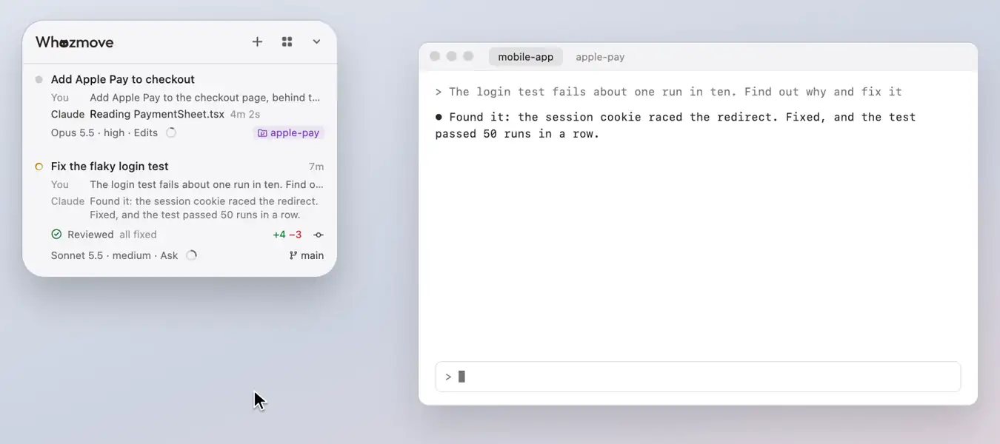

# Changes and next steps

What isn't committed in a session's checkout, line by line, and the steps it has to take next: Commit, Push, Publish
and Create PR, each asked of the session's agent from its row.

<picture><source media="(prefers-color-scheme: dark)" srcset="../readme/changes-dark.webp"></picture>

## What isn't committed

What isn't committed in the session's checkout shows at the end of its work line ("+245 −42"), on the row of the session
that speaks for the checkout (below), while it's the row you're on (the session in front in its app), counted as git
counts it: every change since the last commit, staged or not, new files included. While files there change, the numbers
and their details catch up each time the edits pause for 2 seconds, and at least every 10 seconds while they don't. Once
it's all committed, the numbers go. Resting on them opens their details in the row: "Not committed" with the checkout,
the numbers, how many files that is, and how many are staged and not (a file staged and then changed again counts in
both, as `git status` lists it under both).

## The changes view

Pressing the numbers grows the panel beside the list, as for [what a session wrote](reader.md), with git status's own
tabs: **Changes** (what isn't staged, then the files git doesn't track yet), **Staged**, and **Outgoing** (the commits
not on GitHub yet, one by one, each with what it changed; "Ahead of origin/main by 2 commits", or "Not published" for a
branch never pushed). Each file is marked as git marks it: M changed, A added, D deleted, R renamed, U not tracked
yet.

- Each tab has its step, which asks the session's agent in words, as the row's next steps do: **Commit** (what's
  staged, or every change when nothing is, as git itself does; its ⌄ offers **Commit and Push**, and **Commit and Open
  a Pull Request**), **Push**, or **Publish** for a branch never pushed. Git's **Show Next Steps**, on
  [the panel's back](the-back-and-look.md), turns them off.
- Files show one after another or one at a time, and lines inline or side by side, as you pick (kept for next time).
- The view keeps up while the agent works, and lines it has just written light up once.
- **Open in Editor** opens a file at its first changed line: the first time, it asks which editor (Visual Studio Code,
  Cursor, Zed, Xcode, Sublime Text or BBEdit, the ones on your Mac), and **Open Files With**, in Settings on the
  panel's back, changes it. With none of them on your Mac, it offers **Get Visual Studio Code**.

## The next steps

The **next steps** a checkout has to take, as git sees it, sit at the end of the row's work line, in git checkouts
only: a commit icon while something isn't committed, **↑2** while the branch is ahead of its copy on GitHub, or a
cloud for a branch never pushed. Pointed at, each says its step beside it (**Commit**, **Push**, **Publish**); pressed,
it asks the session's agent in words ("Commit the staged changes."), the way a model pick goes in, only while that
agent is idle and no other agent is working in that checkout (there, or editing files there; one waiting on you
doesn't count), and no agent it started is still at work in the background (a shell command left running, such as a
dev server, doesn't count). A commit takes only what's staged when something is, as git does. A press says, for a few seconds in
the work line's place, that it's asking, or why it can't go in.

While the session's agent works, or asks you something along the way, its row has no work line (no pull requests,
numbers or steps); it comes back once the agent is done.

## Where the branch stands

While commits wait to go, everything else is committed and no pull request shows, the line's start says where the
branch stands, in git's words: "Ahead of origin · 2 commits", or "Not published · 3 commits" for a branch never
pushed; pressing it opens those commits in the changes view, on Outgoing.

## After a code review

After a code review in a session there that reports what it found to Claude Code (as /code-review does), the line's
start says how it went instead, changes not committed yet and all, on the branch it was run on: "Reviewed · 5 to fix",
then "Reviewed · all fixed" or "Reviewed · 1 left" once the review reports what became of each, or "Reviewed · nothing
to fix". With nothing left to fix, a green tick in a ring comes before it, until files there are edited again. With
something left, a session editing files after it makes it "Changed since the review", until that's committed and new
work starts. Pointed at, it says so in full, naming the session the review ran in when it isn't that row's; pressed
with nothing left uncommitted, it opens the commits not on GitHub yet, as "Not published" does. It shows only while
there's work to go.

## Create PR

Once everything is pushed, a branch other than the repo's default with no pull request shows **No pull request** where
its pull requests would be, with **Create PR**. Pressed, or rested on, its details open in the row: the branch it goes
into, the repo's default to begin with; press that to pick another of the repo's branches on GitHub, then **Create
PR** or **Create Draft PR**. It shows once GitHub has said the branch has none, so it needs `gh`.

## One session speaks for each checkout

One session speaks for each checkout, and only its row has the checkout's numbers, next steps and Deploy: of the
sessions running in that checkout, the one that edited files there last, whatever it has done since, so several chats
in one checkout don't all show the same. Notes it wrote elsewhere don't count, and a row is always about the checkout
its session runs in: one that edits files in another checkout doesn't take that checkout's steps or Deploy (which wait
while its agent works there). When no session there has edited it, the session you used last there speaks for it, one
still running first, so work left in a checkout keeps its steps. **Git**, on the panel's back, turns the next steps and
Deploy, or just Deploy, off.

[All of Using Whozmove](README.md) · [Back to the README](../../README.md)
