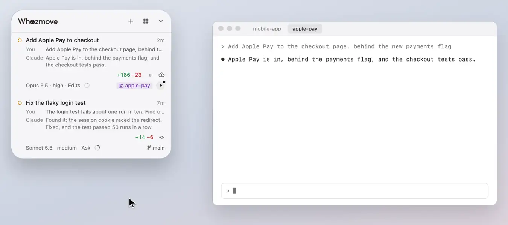

# Deploy

A round play button that puts a checkout's code in place on your Mac with your project's own command, never while an
agent is in the middle of a change.

<picture><source media="(prefers-color-scheme: dark)" srcset="../readme/deploy-dark.webp"></picture>

**Deploy** is a round play button at the end of the bottom line, after the folder it puts in place, for any project
you've set a command up for, or Whozmove can work out one for (a Compose file, a pm2 file, a Makefile `install`
target, a package's `deploy:local` script or its commands, a Rust or Go program, a Python package with scripts,
Whozmove's own `./build.sh --now`). It puts that checkout's or folder's code in place on this Mac, so in a worktree it
runs that worktree's code. While the row asks you something on a line of its own, such as a task for you in One Task
or a team member's ask, it has one button, for what it asks: Deploy goes at the end of an ask to try something, and
isn't on the row at all while anything else is asked. A running server's address stays on the bottom line.

## Setting it up

The first press shows the command it suggests, to change if you like, and asks you to confirm it twice. When you
confirm, the card also shows all the command really runs: each package script it names (with its pre- and post-
scripts, and the scripts those run in turn), each Makefile target's recipe, and each file in the checkout it runs. It
says which files it checks before every run, which programs it runs whose own files decide what they do (those aren't
checked), what it can't follow (a script run in another folder, say), whether it looks as if it could deploy to
production (Whozmove never suggests one that does), and the port it gets there (below). The command is saved for that
project (in Whozmove's folder, never in the project), and from then on the button is always there, for every checkout
of the project, with a dot when an agent has edited files or built there since the last deploy (a turn that only
commits, pushes or runs the tests doesn't count). Until then it's offered only after an agent changes something.

A project Whozmove can't work out a command for has no button until you set one up, from any of its sessions: at the
foot of the session's mode menu, **Let It Deploy** is greyed with **Set Up Deploy…** under it, which opens the same
card on its row with an empty box for your command. Once you've confirmed it, the button is there as for any other.

## A press

A press runs the command at the top of the session's checkout (or in its folder, outside git), in your own shell as
your terminal starts it (so with the PATH your `~/.zshrc` sets, and nothing else of the panel's), and never while that
session's agent is working or asking you something, or another agent is working in that checkout: the button is
dimmed then, and says which session it waits for. Agents a session left at work in the background count as working:
the button names the one it waits for, or how many, and `/tasks` in that session lists them and stops one sooner. A
shell command it left running, such as a dev server, doesn't hold Deploy.

A press on the dimmed button is kept: the row says "Deploys once the agent in “cart total” is done editing fix-cart",
and it deploys by itself once that's done, with everything checked again first (the checkout, the command you
confirmed, every wait, then the port), so the build never catches a file half-written. A press on it then opens its
menu, with **Don't Deploy**. It's kept only while Whozmove runs, and goes if the command changes or is forgotten, if
Deploy is hidden, or if its session closes.

Each checkout gets a port of its own in `$PORT`: 3000 for the project's main checkout, and for each worktree, the next
one no other checkout has, kept from then on (and given back once the worktree has gone). So a website's dev server
that listens on `$PORT` runs in each checkout beside the others.

Before each run, Deploy checks that the files deciding what the command runs in that checkout (its `package.json`, the
Makefile and the files it includes, each file it runs) are as you confirmed them. If a branch or an agent has changed
them, it doesn't run: the set-up card shows what it runs now, for you to confirm again, and a session's ask is refused
until you have. A command confirmed before Deploy checked this needs confirming once more the same way, which gives it
its ports too, unless it runs nothing that's checked.

While it runs, the button shows a stop square in a slowly turning arc and the work line says what's running, in its
place (a row without one gets a line for it); a press then offers **Stop Deploy**, which ends it and everything it
started, and its log. A check shows once it's done. If it didn't go through, a card on the row says so, with the last
lines it wrote (up to five, each cut at the card's edge, its whole text in its tip), **Open Log** and **Try Again**. It
stays until you close it or deploy again.

## A website

A command that starts a server and keeps running, such as a website's dev server (`npm run dev`), runs from Deploy
too: confirm it on the set-up card as any other, and have it listen on `$PORT`. Once it listens, the turning arc
closes into a steady ring round the stop square, the work line comes back, and the address shows after the folder on
the bottom line (`:3001`): a press opens it in your browser. As it comes up, a card says "Deployed: open shop at
localhost:3001", the address a link; the first time for a project, it also says each checkout runs beside the others.
It goes when you open the address or close it, or after 10 minutes. Resting on the button says where it runs and for how
long, and says when other devices on your network can reach it, when it listens on other ports too, and when files
have changed since it started (restart to bring them in, unless the server reloads by itself). Each checkout's
build has its own port, so main's and a worktree's run side by side, at their own addresses.

Before a press runs, Deploy checks the port the build will listen on. If another of its builds is on it (one of a
command set up before ports, or of a server that picks its own port whatever `$PORT` says), a card asks "main's build
is on port 3000. Replace it?", with **Stop It and Deploy**, and where it can, **Use Port 3003** (the next free one,
kept for that checkout from then on) or **Give Each a Port…** (to confirm the command again with ports). If something
Deploy didn't start holds the port, the card says what (by its program's name, and the session that started it, if
one of the listed ones did), with **Use Port 3003**, and **Take Me There** to that session: Deploy only ever stops
builds it started.

A press on its button opens its menu: where it runs, **Open** its address, **Restart** (stop it, then deploy again,
with the same waits; greyed while it waits, saying why) and **Stop Deploy**, which stops it and what it started. If an
agent starts work in the checkout while Restart stops the build, or the build is still stopping 10 seconds on, it
stays stopped and the row says why, for your next press. **Stop Deploy** pressed while Restart waits for the build to
end calls the Restart off, and it stays stopped. A server keeps running when Whozmove restarts, and stops
when the Mac does.

If a server stops before it's up, its card says "fix-cart's build stopped before it was up"; in a checkout with no
packages installed yet, as a new worktree starts, where it couldn't find a program or a package, it says "fix-cart has
no packages installed yet", with **Install First…**, which asks "Run npm ci in fix-cart, then deploy?" and, on **Install
and Deploy**, installs them once, then deploys. The install comes from the lock file in the checkout's top folder, in
the form that leaves it as it is (`npm ci`, `pnpm install --frozen-lockfile`, `yarn install --immutable`, or
`--frozen-lockfile` for Yarn 1, `bun install --frozen-lockfile`), or `npm install` without one, which makes one. The
question also shows what that install runs: the project's own install scripts (`preinstall`, `postinstall`, `prepare`
and the rest), or that it has none, and that its packages' own install scripts run too, which Deploy doesn't check. Just
before it runs, Deploy checks those scripts and the lock file are still as shown; if they've changed, nothing runs and
the question shows them again. The row says "Installing packages first" meanwhile. It never starts while an agent is at
work there: then the row says why, and the card stays, for when it can. If the install doesn't go through, its card says
so ("pnpm install --frozen-lockfile didn't go through in fix-cart"), with its last lines. On both, **Copy and Go**
copies the same install and opens the session in that checkout, to run it there yourself. One that was up and stopped by
itself says how long it ran, where, and its last lines, with **Deploy Again**. A server that hasn't listened on any port
after 2 minutes has a card saying so, with **Open Log**, **Stop It** and **Keep Waiting** (another command still running
says so on its row).

What Deploy can't do for a website:

- It gives each checkout one port, in `$PORT`. An app that also starts a second server (its own API, say) still has
  that one on a fixed port, and two checkouts' builds clash on it.
- Builds side by side share everything but the port: the same database, and the same cookies, as browsers don't keep
  them apart by port, so every site on localhost in that browser sees them. A sign-in that sends you back to
  localhost:3000 works only for the build on 3000.
- A new worktree has no `.env`, and Whozmove never copies one. Install First puts in its packages, not its `.env`.
- A server that Docker or pm2 runs isn't the deploy's own process, so Deploy doesn't see its address. Those commands
  finish, and Deploy treats them as a deploy that went through.
- A dev server an agent started while it worked holds its port: the card names it, with the next free port and the
  session that started it, where it can.
- The log grows for as long as the server runs.
- Many dev servers listen on every address, so other devices on your network can reach them, which resting on the
  button says. To keep one to this Mac, use the tool's own option in the command (`next dev -H 127.0.0.1`); Whozmove
  never adds one.
- Deploy looks only at the checkouts of the sessions listed. A build whose checkout has no session listed keeps
  running, and shows again once one is; meanwhile another checkout's card names it as a program Deploy didn't start.

## Its menu

A right-click (or Control-click) on it shows the command, and offers **Change Deploy Command…**, **Forget Deploy
Command** (back to being offered only after new work) and the last run's log; with only a suggestion, **Set Up
Deploy…** and **Not This Time**. A server that's up has its own menu (see [A website](#a-website)).

Deploy shows on the row that speaks for the checkout (see [Changes and next steps](changes-and-next-steps.md)), and
**Git**, on [the panel's back](the-back-and-look.md), turns it off.

## Let It Deploy

At the foot of a session's mode menu (see [Model, effort, mode and compacting](model-and-compact.md)), **Let It
Deploy** lets that one session ask for its project's Deploy itself, in its own checkout, so an agent can finish a
change and put it in place without waiting for your press. It's greyed until Deploy is set up for the project, with
**Set Up Deploy…** under it.

- The session asks by running `ask-panel.sh put-in-place`, in Whozmove (`Whozmove.app/Contents/Resources`), or
  `ask-panel.sh status` to hear how it went. It runs your confirmed command, from the session's own checkout, the one
  its row is about, as your press would. An ask naming any other folder is refused, with why, so every ask waits on
  the row where you can see it and drop it.
- It waits until no other session's agent is at work in that checkout, no deploy is running there, and you've been
  off the panel for 5 seconds. A build of that checkout that's up (a server) isn't waited for: it's restarted, as
  **Restart** does, and the row says "Restart asked by “its name”" meanwhile; it doesn't wait for the asking session's own turn to end, so a session asks once what it
  changed is ready. Meanwhile the row says what it waits for ("Deploy asked by “its name” · waits until the agent in
  “Other” is done"), and afterwards "Deployed by “its name”".
- When it runs, its port is checked as your press's is. In use, by another of Deploy's builds or another program, by a
  server that takes `$PORT`: it runs on the next free port, which that checkout keeps from now on, and stops nothing;
  `ask-panel.sh status` says which port. By a server that picks its own port, or a command set up before ports: it
  doesn't run, and the card waits for you, saying which session asked; status says so too.
- Deploy's menu says which of the checkout's sessions may ask, and **Not This Time** drops one that's waiting.
- It lasts until the session ends, and only for that session's own process: resumed somewhere else, it's off until you
  turn it on again there. It ends too once the project's command changes or is forgotten, or Deploy is hidden.
- A session in Claude Code's sandbox can reach the panel only once you allow its socket in that session's settings
  (`sandbox.network.allowUnixSockets`, with `~/Library/Application Support/Whozmove/ask.sock`); until then the script
  says it can't reach the panel, and to tell you rather than change a setting itself.
- Like Deploy's command, what you've allowed is kept in Whozmove's folder (`allowed/`), where any program running as
  you could change it: it keeps a session from doing more than you allowed it, not a program set on doing harm.

[All of Using Whozmove](README.md) · [Back to the README](../../README.md)
