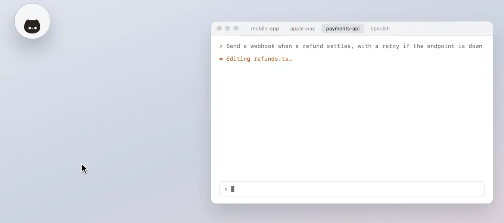

# The folded panel

Folded, the panel is a small round piece of glass with Whozmove on it, and what needs you comes out beside it by
itself.

<picture><source media="(prefers-color-scheme: dark)" srcset="../readme/folded-dark.webp"></picture>

## What needs you comes out beside it

While the panel is folded, a request, a question, a plan or a reply you haven't read comes out beside it by itself, as
its row from the list, so you can answer it there, or press it to open its session. Where the list's rows are short,
it shows its whole row, so it says what's new. A reply to a
message another session sent went there, not to you, so it doesn't come out. With **Show Conversation Text** off in
Settings, one that comes out for a reply shows its name and time, without the reply ([The
list](the-list.md#hiding-the-conversation)).

- In the order they came, the first nearest the panel and each new one after the others, three at most: one that
  comes while three are out waits its turn, and none goes back in for a newer one. Each stays out for 45 seconds, the
  time it has left a ring round its × that empties as it runs out.
- A request, a question or a plan comes out even while its session's tab is in front, as the session can't go on until
  you answer, and goes once you've answered it there. A reply that comes while you're in its tab is read there, and
  doesn't come out. Each comes out once for what's new: a reply you've seen there doesn't come out again after a
  request has come and gone in its session.
- Pointing at one, typing in it, or being in its session's tab after pressing it (or its row) keeps them all out, and
  nothing new comes out meanwhile, until you leave that tab.
- Click a request or a question there and its keys are the panel's, as on the list, until you answer, press Esc or
  click elsewhere: Return allows once, and 1 to 9 pick a question's option. It stays out while its keys are yours.
- The pin keeps one out, × sends it back, and under them it says how many more are waiting.

Which come out first is decided with everything else that needs you: [What needs you](notifications.md).

## Rest the pointer on it

Rest the pointer on the folded panel and it opens, headed with how many are waiting on you; move off and it folds
back. Press it to keep it open. What's out beside it goes into its row as the panel opens, and back out as it folds.

The chevron in the panel's header folds it, and so does a press on Whozmove beside the panel while the header has
scrolled away, right where it is (see [The list](the-list.md)).

[All of Using Whozmove](README.md) · [Back to the README](../../README.md)
