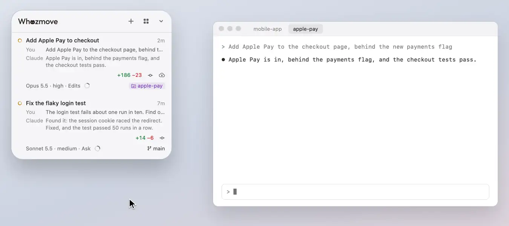

# Model, effort, mode and compacting

A session's model, effort and permission mode, and how full its context is, at the start of its row's bottom line
while it's the row you're on (the session in front in its app), each changed from there while the session sits idle.
On another row, the context ring sits at the end of the line under its name, when it has one.

## Model, effort and mode

Click one to change it while the session sits idle. Never while it's working or asking you something, since a key
typed into a permission prompt would answer it.

**In Ghostty or iTerm2**, the panel types `/model …` or `/effort …` into the session's tab (a half-typed draft is
stashed and comes back), or presses Shift+Tab for the mode.

- In iTerm2, with its Python API switched on (iTerm2's Settings ▸ General ▸ Magic ▸ Enable Python API), the keys go
  into that session alone, whatever else its window holds. With it off, the panel types only into a session alone in
  its window, with no other tabs or panes there: iTerm2's Broadcast Input can copy what's typed into the others, and
  no script can tell whether it's on, so for a session that shares its window the menu says so, and offers **Turn On
  iTerm2's Python API…**, which brings iTerm2 forward with its Settings turned to that box and ticks it; iTerm2 asks
  you to confirm. A switch on iTerm2's page on [the panel's back](the-back-and-look.md) does the same.
- Those commands also save your choice as the default for new sessions, so the panel puts your default back (only
  that setting, and only when the command says it saved it).
- The mode menu offers only the modes it can reach with a known number of presses. Auto isn't in every session's
  Shift+Tab cycle, so unless the session is in Auto now or your settings turn Auto off, the menu offers just the moves
  that are the same either way, and says to change the others in the terminal.
- At its foot, **Don't Wait on Me**: questions and requests no one answers in 5 minutes go, and Claude carries on (see
  [Requests, questions and plans](requests.md#dont-wait-on-me)); **Let It Deploy**, while Deploy shows: the session
  can ask for its project's Deploy itself (see [Deploy](deploy.md#let-it-deploy)); and, on the row of the session
  leading a team ([With a team](the-list.md#with-a-team)), **May Send Back Plans**, **May Answer Questions** and **May
  Approve Plans**: it can send back a team member's plan with a note, answer its questions, or approve its plan (see
  [plans sent back](requests.md#plans-sent-back-for-you), [questions answered](requests.md#questions-answered-for-you)
  and [plans approved](requests.md#plans-approved-for-you)). After Whozmove restarts those three are off, and **Turn Back
  On** above them turns back on the ones you had ticked, with one press (see [After Whozmove
  restarts](requests.md#after-whozmove-restarts)).
- When switching model would re-read a cached conversation, Claude Code's "Switch model?" is asked on its row in the
  panel instead (Claude Code 2.1.304 or later, in sessions started since Whozmove's hooks were put in place), saying
  the model it would switch to and how much the conversation holds: **Switch** goes on, **Keep** (with the model's
  name) keeps the model, and with no answer within a minute Claude asks in the terminal.
- While a pick goes in, its row says so ("Switching to Opus 5.5…"); if Claude Code asks anything else first (its
  "Change effort level?", which no hook can answer), the row says Claude is asking in the terminal, with **Take me
  there**, until it has your answer. The tab doesn't come forward by itself. Meanwhile the other menus, Compact and
  next steps say a change from the panel is still going in.

**In Claude Desktop**, the same slash command goes into the conversation's own message box and is sent with its Send
button through the Accessibility API, so nothing is typed and no menus open. Return is pressed only if Claude shows
no Send button, and only while Claude is in front. Claude switches to the conversation first if it isn't showing it.
The mode menu offers only Plan, since `/plan` is the only slash command for a mode, and nothing is sent while you have
a message half-written there. Claude's "Switch model?" (a model switch re-reads a cached conversation) is asked on its
row in the panel instead, and your answer goes to Claude's box. This needs the Accessibility permission for Whozmove.

## The context ring and Compact

<picture><source media="(prefers-color-scheme: dark)" srcset="../readme/model-dark.webp"></picture>

A ring shows how full each session's context is. Pointed at, it widens into a **Compact** button that says how full
it is ("98% · Compact"), filled the same way, and where the session runs makes way for it. A click opens a card with
how much is left before auto-compact ("427k left") and three ways to compact: **Compact**, **Keep details** and **Keep
essentials** (the last two are `/compact` with instructions for what the summary keeps), or your own focus. It goes in
like a model pick, while the session is idle. While the row asks you something on a line of its own (a task, a team
member's job), the ring steps aside until it's answered, so the ask has one button.

Claude's line says "Compacting the conversation" until it's done. Whenever a conversation compacts, by itself or asked
for, the ring becomes a short arc going round, and once it's done it fills to the new size.

**Compact now.** When it's a good time to compact, the ring opens by itself and says "98% · Compact now", and why when
you point at it. That's at a natural break, never for its size alone: while the session sits idle at its prompt, once
its conversation is big (200k or more), when its work has just been saved (committed, pushed, merged or deployed), when
it's nearly full and Claude would soon compact it by itself in the middle of a task, or when you've been away from it
for an hour.

**Compact at Breaks.** Turn it on in Settings, and a long conversation in Ghostty or iTerm2 is compacted for you at one
of those breaks, while it sits at its prompt, never while Claude works or asks. It waits until the turn has been over
for a couple of minutes, and never compacts a session you've been on in the last five minutes, the one in the
terminal in front while you're at the Mac, one also open in Claude Desktop, or one while you're using the panel.
Being away for an hour stays a suggestion on the ring for you to press: by then Claude would read the whole
conversation again to compact it. Its `/compact` asks Claude to keep exactly where the work stands: the task, your
instructions and decisions in your own words, what's done and what's left, and what it's waiting for. Its row then
says "Compacted at 1:12" beside the ring until its next message, and pointed at, why and how big it was before and
after. If it couldn't, it says "Couldn't compact" there, and pointed at, why; if it stopped part-way, the row's note
says to check its prompt, with Take me there: part of `/compact` may be left there, and what you had typed there is
kept aside. When it would compact a session but can't (an iTerm2 window with other tabs, say, or before macOS has let
Whozmove control the terminal), the ring's tip says why, and its card offers the way past it when
there is one.

[All of Using Whozmove](README.md) · [Back to the README](../../README.md)
