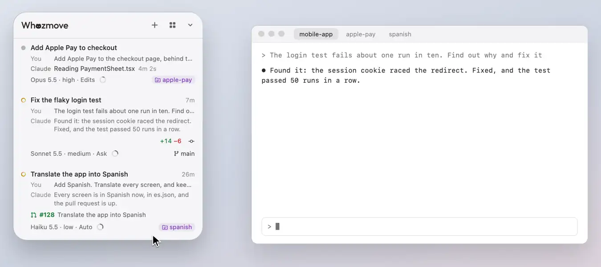

# Starting a conversation

Write what Claude should do, choose where, and it starts in Claude Desktop, Ghostty or iTerm2.

<picture><source media="(prefers-color-scheme: dark)" srcset="../readme/start-dark.webp"></picture>

## The card

Start a conversation from the ＋ in the panel's header, a project's ＋, or ⌃⌥N from any app: a card opens at the top
of the panel, under the header; write what Claude should do and press ⌘Return (Return starts a new line). The card is
shaped like the row it becomes. Once started, the card turns into that row and moves down to its place in the list,
where it says it's starting until Claude lists the conversation. Close a card before it starts and the next one comes
back as you left it: your words, where it starts and the app.

## Where it starts

Chips under your words say where it starts: the project (that of the session you're on, at first) and, in a git
repository, where in it. Type **@** in your words, or press the project's chip, to choose another project (or any
folder), and the line under the box says where it runs.

In a git repository, type **#** (or press the branch's chip) to choose where in it: its own folder, a worktree that's
there, or a new worktree, a folder of its own, for a branch that's there or a new branch named from your words
(**#name** names it, and **#name from release** starts it from that branch, else from the repo's main branch as this
Mac has it, which it then follows).

- A new worktree is in the worktree colour, with the branch it starts from beside it; anything in a worktree starts in
  a terminal.
- Nothing ever switches the branch of a folder in use: a branch is only checked out in a new folder.
- When another agent is at work in the project's folder, or changes there aren't committed, the card says so, with
  **Use a new worktree**.
- A new worktree goes in a folder beside the repo, named after it (`~/code/shop-worktrees` for `~/code/shop`), never
  inside it, or in a folder you choose from the line under the box, kept for that repo.

## A ticket

After where it starts, the **Ticket** chip gives the conversation a ticket from Jira: find one as you type, paste its
key or link, or create one, talked through with Claude and made only once you press Create Ticket on its row; or sign
in with Atlassian first. A ticket's link pasted into your words becomes the chip by itself.
[Tickets](tickets.md) has the rest.

## The app it starts in

The Start button shows the app it starts in, its icon and, once you've written something, its name, saying **Start in
Claude** while you hold ⌘; the arrow beside it switches between Claude Desktop, Ghostty and iTerm2 (those on your
Mac), and the next card starts with the one you chose last. With **Track Claude Desktop app sessions** off, on Claude's
page on [the panel's back](the-back-and-look.md), new conversations start only in a terminal.

- **In Claude Desktop** your words go into the new conversation's message box, Whozmove chooses the folder's
  environment among the recent ones Claude lists (when Claude hasn't already) and presses Send once Claude shows it.
  This needs the Accessibility permission; without it, if the folder's environment isn't among Claude's recent ones,
  or if Claude doesn't take the press, your words wait there for you to choose it and send. If Claude starts it in
  another folder anyway, the row follows it there and says so.
- **In Ghostty or iTerm2**, a new tab runs `claude` with them.

## A folder Claude hasn't worked in

A folder Claude hasn't worked in before is asked about on the card (**Trust and start**), so neither Claude Desktop nor
Claude Code stops to ask again.

## ⌃⌥N

⌃⌥N opens the card from any app, and **New Conversation** in Whozmove's menu in the menu bar does the same. **New
Conversation with ⌃⌥N**, in Settings on the panel's back, turns it off for other apps. While the panel is turned over,
⌃⌥N turns it back to start a conversation.

[All of Using Whozmove](README.md) · [Back to the README](../../README.md)
