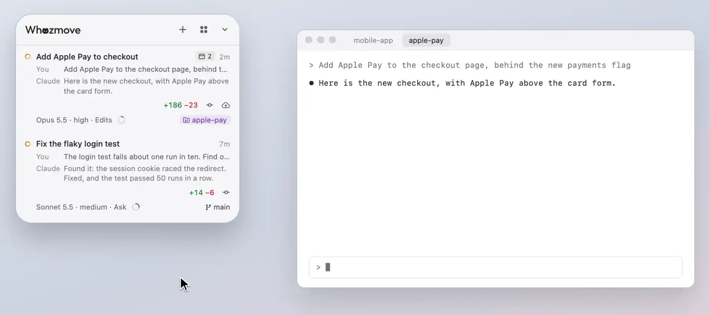

# What a session wrote

A session's plans, prototypes and notes, read beside the list without leaving the panel.

<picture><source media="(prefers-color-scheme: dark)" srcset="../readme/notes-dark.webp"></picture>

What a session wrote for you to read is on a tag on its row, quietly as its icon and how many (in the plan's colour
while a plan waits for you). Press it and the panel grows at once beside the list, which stays where it was, saying
where what's shown is coming from (the session's transcript, or a file) until it's in, then fits it (up to the
screen's edges; a long plan scrolls), with the session's **Plans**, **Prototypes** (`.html` pages it created) and
**Notes** (`.md` files it created) beside it, newest first. Drag it by either header to move it, reader and all. ✕
(or the tag again) folds the panel back to the list, where the list is now, and so does Esc once you've clicked in it,
as One Task's does too. Opening it leaves your typing where it was, so Esc goes to the app you're in until you click in
the reader; then, until you click into one of its boxes, only Esc acts there, so typing meant for another app presses
nothing in it. In a box with words typed in it, Esc leaves the box keeping them, and the next Esc closes the reader;
on a request you've clicked, the first Esc gives its keys back, and the next closes the reader.

## Plans and notes

Plans and notes read as formatted text, a flow diagram in them drawn ([Diagrams](plans.md#diagrams)). A plan opens on
its short view, with the rest folded under it, or, with **Full version of the plan**, exactly as written, wherever
there's one to show ([Plans at a glance](plans.md)). A plan Claude is waiting on can be sent back with your notes
(**Send back…**: Claude stays in plan mode and writes a new version) or stopped; approving it happens in the session,
where **Take me there** brings you. Only a session you allow to approve plans for you (May Approve Plans, see [Requests,
questions and plans](requests.md#plans-approved-for-you)) approves one from the panel.

## Prototypes

A prototype opens from its file once the panel has grown, as it would in a browser: the pictures, scripts and styles
beside it, the scripts, fonts, pictures and frames it names from the web, its own links (one to a site or a page
elsewhere on your Mac opens in your web browser), what it saves, light or dark as the panel is, and nothing in it can
reach anything else. Click into it to point and type in it (the panel has the keyboard until you click the list again);
**Open in Browser** opens it in your web browser, for what the panel doesn't do (its own windows, files, downloads, a
link to any other file outside its folder), and the line above it says when it asked for one of those. It loads again,
where you were, when the session changes it.

[All of Using Whozmove](README.md) · [Back to the README](../../README.md)
