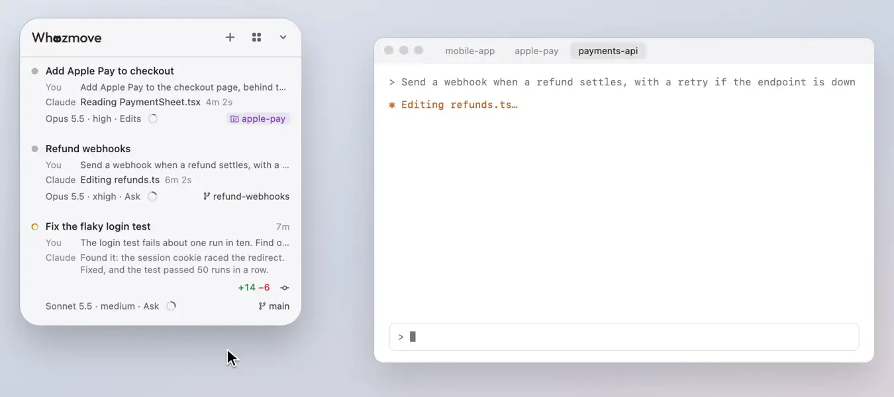

# Requests, questions and plans

When Claude needs your OK or an answer, you can give it on the session's row, without switching to it. A request stays
on its row: One Task, beside the list, holds only the tasks sessions hand you, so nothing shows in two places.

<picture><source media="(prefers-color-scheme: dark)" srcset="../readme/requests-dark.webp"></picture>

## When a request comes

A request, a question or a plan comes into view by itself: the list scrolls until its whole card shows (from its top,
if it's taller than the list), and a newer one takes its place if you haven't acted yet.

- While you're answering a card (you've clicked it, or you're typing in one of its boxes), or your pointer is on the
  panel, the list doesn't move by itself. Once you scroll the list yourself, it stays where you put it: a request is
  brought into view once at most.
- Whenever a request waits out of sight, a strip slides up at the list's edge it's beyond, and slides back away as
  soon as any of its row is in view again or you answer it: at the top, the bottom, or both at once when requests wait
  both ways. A request is never shown twice: while any of its row shows, there's no strip for it, and the row you're
  on, held at the edge, needs none. Each names the request nearest
  its edge and what it asks, with "after this" while you answer another and how many more wait past it; press it to go
  there now.
- At an edge, the strip and the row you're on, held there as you scroll past it, keep the list's order: at the top,
  whichever comes first in the list is at the very edge and the other just inside it, and at the bottom, whichever
  comes last. They never trade places as you scroll.
- Once you've answered, the list goes to the request that has waited longest.
- The card you're answering or pointing at stays where it is as rows move round it.
- Folded, the panel doesn't open for a request: it comes out beside the folded panel instead (see
  [The folded panel](folded-panel.md)).

## Permission requests

A permission prompt waiting can be answered on the row, under Claude's line, which says what Claude wants ("Wants to
run a command", "Wants to edit total.ts"). Its card shows exactly what the agent wants to do, with **Deny** and
**Allow once**, never "always allow":

- **A command:** Claude's reason for it as the title, whole; "Outside the sandbox" (in red) and "Keeps running" as tags
  where they apply; then the command, wrapped, every line of it whole: up to 4 lines show in full, and a longer one
  shows its first 4 with **Show all**. A command that would run outside the sandbox fills the card in red.
- **An edit:** the file's name, its folder inside the project, and how many lines it puts in and takes out (+2 −1);
  then the lines it takes out (−) and puts in (+). A change made in 3 or more edits shows one at a time, with ‹ and ›
  to step through them ("1 of 4"), and says that **Allow once** allows all of them, whichever shows.
- **A file written whole:** its name, folder and length, then its first lines.
- **A file read** or **a web search:** one line.
- **A page:** what Claude wants to learn from it, with its address under it.
- **A connected app's tool:** the app, what it would do, and its fields: words to read (a description, a message's
  body) as text, anything else as code.
- **Any other tool:** in plain words where the panel knows it, else its fields.

On every card, the answers (**Deny** and **Allow once**, **Submit**, **Take me there**) sit in one place: its foot, on
the right. A request's title wraps to as many lines as it takes. Code and changes (but a command, above) sit on the card
with no box of their own, a line each, fading where the card cuts a long one; wherever any of it is out of view (past a
few lines, or a line wider than the card), **Show all** shows the whole, wrapped. A path, an address or the words
searched always show whole, a path or an address wrapping at its slashes.

- Each part shows up to 100,000 characters; past that the card says Claude sent more than the panel can show, with
  **See it in the session**, and **Allow once** still allows all of it.
- Claude's own prompt stays usable too, and whichever you answer first counts.
- Click the card and its keys are the panel's until you answer, press Esc or click elsewhere: Return allows once.
- Once you've answered, a line says so where the card was ("✓ Allowed once · npm install"), until Claude goes on; still
  there after a few seconds, it offers **Take me there**, where the request can be answered too. On a conversation
  beside the folded panel there's no such line at first: the card goes, Claude's line says what you answered ("✓
  Allowed once · npm install") and its dot turns to the working one, so the conversation shrinks once, to its height
  without the card, the line coming only if the answer hasn't landed after those few seconds, with Claude's line
  asking again above it.
- Sub-agents' requests and sessions that aren't interactive (`claude -p`) are left to Claude's own prompt.

## Claude's questions

Claude's questions (its question tool) are answered on the row, Claude's line saying what about ("Asks about
Checkout"), and × dismisses them without answering:

- **One pick:** its options, numbered, each with what it means, and **Type an answer**. One press answers: there's no
  Submit. A card that has only just come up takes no press, so one appearing under the pointer isn't answered by
  mistake.
- **Several picks:** "Pick any", boxes to tick and **Type an answer**, then **Skip** or **Submit**; what you type goes
  with the boxes you ticked.
- **Several questions:** one at a time, with ‹ › and where you are ("2 of 3") at the top. Each has its options,
  numbered, and **Type an answer**, or a box where the question takes typing; a pick only picks. **Skip** leaves it
  out and moves on; **Next** moves on whether you've answered it or not, as one you leave is skipped too. The last
  has **Submit**, with your other answers in a line above it ("With: Under the total"), or, while none is answered,
  what to do instead. A question that has only just come into view takes no press for a moment, so a quick second
  press meant for the one before doesn't land on it; its keys work almost at once, so typing through the questions
  loses nothing.
- **A number:** − and + beside it, its unit and its range (in red while what you type is outside it), and **Submit**.
- **A typed answer:** its box, then **Skip** or **Submit**.

On any question with options, **Type an answer** becomes the box itself, in its own row: Return sends what you typed,
and Esc gives the row back, keeping your words, which the row then shows. On a question with one pick, the last thing
you press wins: a pick replaces words you typed, and typing replaces the pick.

Every option shows its name with what it means under it, and what a question is about (its subject, "Pick any") is a
small label above it.

Once you've clicked the card, the keys work on it too, rather than reaching Claude's own copy of the question in the
terminal: on one pick, 1 to 9 answers with that option (the number after the last opens the box to type in, and Return
sends what you typed); on several picks, 1 to 9 tick and untick; on several questions, 1 to 9 pick on the one in view,
← and → move between them, as in Claude Code's own box, and Return presses Next (Submit, on the last). Elsewhere,
Return submits.

Whozmove's Claude Code plugin gives every session a skill for writing its questions (`whozmove:asking-questions`), so
they read at a glance: one thing to decide in under 70 characters, two to four options, each named in four words or
fewer with one line of what it means, the one Claude would pick first, and a file for anything that needs a paragraph.
Like the hooks, it reaches sessions started after Whozmove's update.

## Plans

While Claude waits on a plan, its row asks for your OK in a bubble: **Plan** and the plan's title, ending in the
plan button. Press it, and the whole plan opens beside the list (see [What a session wrote](reader.md)), with
**Approve**, **Send back…**, **Stop** and **Take me there** under it. **Approve** approves the plan as it's shown there,
and only by your press: Return never presses it, and a press the panel can't tell came from you at the Mac isn't
taken (the bar says so, and **Approve** stays to press again). A press approves only the version you read: if Claude
has asked again with a new one, that one shows in its place, to read first; and if the plan's file has changed since,
it isn't approved, and the bar says why. A plan too long for the panel to show whole, or from a session that might bypass permissions once its
plan is approved, can't be approved there: the bar says why, with **Take me there**. Once approved, the row says
"✓ Approved" until Claude goes on, and the bar says it's waiting for Claude to take it; if Claude doesn't, both say
your approval wasn't taken, and the bar offers **Take me there**, where only its tab can answer it now. A plan asks in
the panel for an hour at most, and not past a restart of Whozmove; after that, the plan button still opens it beside
the list. While Claude Code's own prompt for it is up in its session, it's answered there, and the bar says so, with
**Take me there**. Once the session is idle at its prompt with nothing typed in since, **Send back…** types your notes
into it as a message, on your press, and the bar says how that went: typed in, or why not, with the way past it where
there's one. Approve and Stop are its session's then. A team member's plan shows
the same way, in its job's bubble ([A team member's row](the-list.md#a-team-members-row)).

Where another ask has the row's line (a task One Task gives that session, say), it keeps it: the plan's tag after
the session's name, in the plan's colour, opens the plan beside the list. A plan never has a card on its row.

A session started before Whozmove's update asks the old way, which the panel no longer answers, as anything running
as you could answer it that way too: its row says to answer it in the session, with **Take me there**. Start the
session again to answer it here.

## Don't Wait on Me

At the foot of a terminal session's mode menu (see [Model, effort, mode and compacting](model-and-compact.md)), **Don't
Wait on Me** lets the session carry on while you're away: ticked, a question or a request for your OK that no one
answers in 5 minutes goes, and Claude carries on with what doesn't need it and asks again later. It's never allowed for
you, and the turn isn't stopped.

- The card says when it goes: a ring at its title's end, emptying as the time runs out, with the minutes left ("4m");
  pointed at, "Goes by itself if no one answers".
- It waits while you're answering it, on the row or in the session's tab with you at the Mac, and for at least a
  minute after.
- A plan never goes: it waits for you, as always.
- It types nothing into the session, so it can be ticked whatever the session is doing; the line under it says what
  it does, or why it can't be turned on now.

## Plans sent back for you

When a session leads a team of other sessions for you, with a team file (see [With a team](the-list.md#with-a-team)),
you can let the session leading it send back a team member's plan for you, so you needn't go to the member's tab. Tick
**May Send Back Plans** at the foot of that session's mode menu. When you tell it to send back a plan, it can, for that
plan: one a member of the team waits on, in the same project, with a note that says what should change. The switch lets
it act on your word; it isn't meant to act without it. Claude gets it as your "keep planning" answer would come, marked
as sent back by that session for you, and writes a new version.

- This switch never approves a plan, and answers nothing else: no request for your OK, question or model switch
  (questions and approving plans have switches of their own, below).
- Only the team's members, as the team file names them, in the same project: never one of your own sessions, and never
  the session's own plan.
- The member's row says so for 30 minutes, in a card under its chat while nothing else waits there: "Atlas answered
  for you · 1m", then "Sent the plan back: “Split step 2 first.”".
- You can always answer first: beside the list, or in its tab. While you're answering it there, the
  session is told to leave it to you, and once it's answered, a send-back that comes later does nothing.
- The switch is kept for the lead's folder while Whozmove runs, and nothing written on your Mac can turn it on: a new
  session leading the team there has it with nothing to press (see [A new session in the same
  folder](#a-new-session-in-the-same-folder)). An update of Whozmove (Deploy, a new build), or quitting it, turns it off,
  and one press at the foot of the mode menu turns it back on (see [After Whozmove
  restarts](#after-whozmove-restarts)). Untick it to stop at once, for that folder; a plan already sent back has been,
  so tell the session in its tab if that wasn't right. The line under the switch says the folder it stays on for, and
  counts how many plans this session has sent back.
- The session asks with `ask-panel.sh`, which every build carries (`Contents/Resources`): `waiting` lists the plans
  it may send back, each with its id, and `send-back <id>` sends one back, with the note given on stdin. A session in
  Claude Code's sandbox reaches the panel only once you allow its socket in that session's own settings
  (`sandbox.network.allowUnixSockets`: `~/Library/Application Support/Whozmove/ask.sock`).
- It needs sessions started after Whozmove's update: an older session's plan is answered in its tab.

## Questions answered for you

The same way, **May Answer Questions**, at the foot of the mode menu of the session leading the team, lets it answer a
team member's questions for you (Claude's question box) when you tell it to, for that question: it picks one of the
question's own options, or writes an answer, for every question it asks.

- Claude gets each answer as your own would come, marked as chosen for you by that session, and as no OK of yours for
  anything that needs your permission. It answers nothing else: never a request for your OK, a plan or a model switch.
- The same limits as plans: only the team's sessions, in the same project, never one you're answering, and kept for
  the lead's folder while Whozmove runs (after an update of Whozmove they wait for [one
  press](#after-whozmove-restarts)). The member's row says what was answered and by whom, in the
  same card, for 30 minutes: "Answered: Which index? “Titles”".
- With `ask-panel.sh`, `waiting` lists the questions too, each with its options, and `answer <id>` answers one, with
  the answers given on stdin as JSON: `{"Which index?": {"option": "Titles"}}`, `{"options": [...]}` where several may
  be picked, or `{"written": "…"}`.

## Plans approved for you

**May Approve Plans**, the third switch at the foot of the mode menu of the session leading the team, lets it approve
a team member's plan for you when you tell it to, for that plan, so the member starts building without your going to
its tab. Claude gets it as your own approval in its prompt would come ("User has approved your plan"), and goes back
to the mode it planned from.

- Only the plan as listed: `waiting` gives each plan's text with its digest, and a plan whose file has changed since
  Claude asked is refused; you approve that one in its tab.
- The same limits as the other two: only the team's sessions, in the same project, never one you're answering, kept
  for the lead's folder while Whozmove runs. And never a session that could switch to bypassing
  permissions, nor one started before Whozmove's update: those you approve in their tab. A lead that could bypass
  permissions itself doesn't hold it either: the switch is greyed on its row, saying what to change.
- The member's row says so once Claude Code has taken it, in the same card, "Approved the plan: “Search box”", with
  **Read plan** and **Take me there**, for 30 minutes. If Claude Code didn't take it, the card says so, in red, and the
  plan still waits in its tab for you.
- An approved plan has started: to stop it, **Take me there** and press Esc in its tab, or tell it, as you would. Untick
  the switch to stop the next one at once.
- With `ask-panel.sh`, `waiting` lists each plan with its text, what may be done with it and its digest, and
  `approve <id> <digest>` approves it.

## A new session in the same folder

The three switches belong to the folder of the session leading the team, not to that one session. Close it and start a
new one there, or clear it, and once the team file names the new conversation as the lead, the switches you ticked are
on for it, with nothing to press. A line under the header says so each time: "May Send Back Plans, May Answer
Questions and May Approve Plans came on for a new session in Ghostty, started at 9:40: kept for shop while Whozmove
runs", with **Take Me There**. It names the session by what macOS says of it (its terminal app and when it started),
never by a name a file gives it, and it stays until you close it, even once that session has gone. Panel.log keeps the
same, for each one.

The team file is written by the sessions themselves, so Whozmove checks each session that would hold the switches
against what macOS says of its process, not what any file says. They're on only for a session that:

- works in that folder (or a folder inside it);
- is Claude Code's own program, signed by Anthropic, as Claude Code from npm is from 2.1.113 on. An older one from npm
  can't be checked that way, so it never holds them, and its row says to update Claude Code and start it again;
- wasn't started by another session's command;
- is the only Claude Code session in that folder: while a second one runs there, the switches are off, and the line
  under each names the other session, with **Take Me There** under it. The team's own members working in folders of
  their own inside it don't count.

Where the reason is an older Claude Code from npm, **Get Claude Code** under it opens the page for Claude Code's own
build.

Where one of these doesn't hold, the switch shows a dash, not a tick, on every row in that folder, with the line "Kept
for shop, off now", and why. Pressing it stops keeping it for the folder, so you can always take it away. A session
that opens Claude Code in a new terminal tab in that folder while no other runs there, and records itself as the lead,
gets the switches: the line under the header is how you see it.

A folder no session has held the switches in for 7 days stops being kept, so one left behind (the lead moved to
another folder) doesn't keep them for good.

## After Whozmove restarts

The three switches are kept only while Whozmove runs, so an update of Whozmove (or Whozmove starting again after a
crash) turns them off, and so does quitting it. Nothing comes back by itself: at the foot of the mode menu of a session
leading the team in that folder, above the switches, **Turn Back On** names each one you had ticked, and the folder ("Turn
Back On May Answer Questions and May Approve Plans for shop"), with the line "They went off as Whozmove restarted". One press turns all of
those back on. A line under the header says the same, naming the session and the folder, until you press it; its ×
puts it away.

- It's offered on the row that shows the switches, for any session there that may hold them, as above. It names only
  the switches one press can bring back now, so May Approve Plans held back on a session that could bypass permissions
  never keeps the other two from coming back. Only when none can is it greyed, with the reason (the session open in two
  places: close the copy you don't use first). Ticking one by hand takes it off the offer.
- A session that asks with `ask-panel.sh` while its switches wait is told they're off since Whozmove restarted, and that
  you turn them back on with one press in its mode menu.

[All of Using Whozmove](README.md) · [Back to the README](../../README.md)
