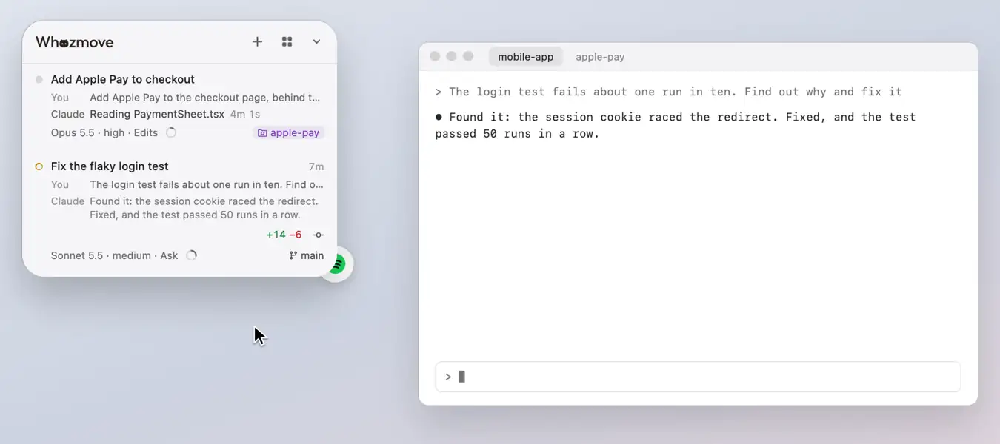

# Spotify and lyrics

What Spotify is playing, at the bottom of the panel, with its controls and, if you like, its lyrics.

<picture><source media="(prefers-color-scheme: dark)" srcset="../readme/spotify-dark.webp"></picture>

## Its token

**Spotify** lives in a round token tucked half under the panel's bottom corner, on the side facing the middle of the
screen (it travels under the panel to the other corner as you drag the panel across). Bring the pointer near and it
leans out to meet it; press **Play** and Spotify opens in the background if it's closed and plays what it last had.
Paused a while, the token wears the song's cover with a ring for how far in it is, and resumes it. Without Spotify on
this Mac it offers **Download**, Spotify's download page, and turns into Play by itself once Spotify is installed.
Signed out, Spotify comes forward to sign in, and the music starts once you have. macOS asks once whether Whozmove may
control Spotify, at the first Play or song.

## Now playing

**Now playing** is at the bottom of the panel while a song plays: the cover, the song and artist, how far in it is (a
thin line along the top) and the time. Point at it for back, pause and next, and press the line to jump; press the
strip to bring Spotify forward (once lyrics are on, to read them). A new song rolls in place; paused, it greys and
offers Play, and after 15 minutes it folds into the token; with the panel folded away, neither the strip nor the token
shows.

**Spotify**, on [the panel's back](the-back-and-look.md), has **Show the song** (off, the token and the strip go, and
Whozmove leaves Spotify alone), **Lyrics**, **Its icon at the panel's corner** and **Open Spotify**. macOS's Allow
stays in System Settings → Privacy & Security → Automation.

## Lyrics

**Lyrics** come once you say yes to the strip's question (or turn on **Lyrics** on Spotify's page): while a line is
sung, it takes the place of the song's name in the strip, rolling in as the singer starts it, with the lyrics mark over
the cover, and the name and the cover come back between verses.

- Press the strip to read the whole song beside the list, the line being sung lit as it plays; press a line to jump
  there.
- Pressed before a song's lyrics are here, the strip says "Loading lyrics…" or "Lyrics not available" for a moment
  instead, and they open if they come meanwhile.
- At their foot, **Show lyrics in the strip**, turned off, keeps the strip on the song's name, and **Open Spotify**
  brings Spotify forward.
- They come from LRCLIB (lrclib.net), a free library of lyrics that says when each line is sung: a song it doesn't have
  keeps its name in the strip, words without timings show beside the list only, and when LRCLIB is busy, Whozmove asks
  again, a little later each time.
- A song you've played before shows its lyrics at once, as they're kept on this Mac.

## Quieter while you talk

While you talk to Claude by voice, Spotify's music is turned down, and once you've stopped, back up to exactly where it
was.

- **What counts:** Claude Code's voice mode in any terminal, Claude Desktop's dictation, and a dictation app such as
  macOS Dictation into a session's tab in Ghostty or iTerm2, into Claude Desktop, or into one of the panel's own boxes.
  A call that was already going when you came to a session doesn't count.
- **How it moves:** as you start, the volume turns down a point at a time, as a steady hand turns a knob, to the level
  you picked, about 3 seconds for half. A pause inside one talk keeps it down. Once you've stopped, it waits
  3 seconds, then turns back up the same way, a little quicker. A small speaker beside the strip's time shows while it's lowered.
- **Your volume wins:** change Spotify's volume yourself meanwhile, and it stays as you set it.
- **Spotify's page** on [the panel's back](the-back-and-look.md) has **Quieter while you talk to Claude**, and under
  it how much quieter: **A little**, **Half** or **Much quieter**. While Whozmove isn't allowed to control Spotify yet,
  a card there offers **Allow** (or **Open Spotify** while it's closed, or **Open Settings** once you've said no).
- A dictation app that mutes music while you dictate silences it anyway: turn that off to hear the music lowered
  instead.
- Whozmove reads only which app is using a microphone, never the sound, and needs no microphone permission for it.

[All of Using Whozmove](README.md) · [Back to the README](../../README.md)
