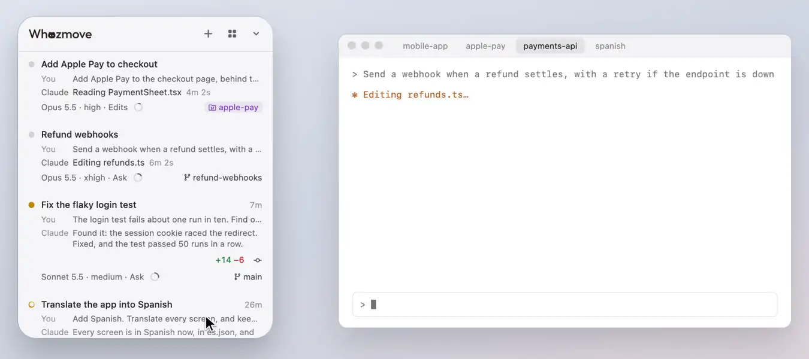
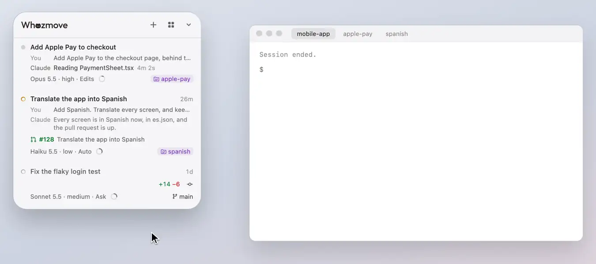

# The list

Every Claude Code session on your Mac, in Claude Desktop and in the terminal, one row each, with whose move it is.

<picture><source media="(prefers-color-scheme: dark)" srcset="../readme/hero-dark.webp"></picture>

## How tall it gets

The panel grows with the list until the header and the list together are 640 points tall, then the list scrolls. A
line under the header, a new conversation's card and the strips at the list's foot come on top of that. The panel ends
high enough above the screen's bottom for the [usage card](usage.md) under it to open whole, so a panel dragged low on
the screen gets shorter, and its list scrolls sooner, unless it's dragged so low that only its header, the lines under
it and a row fit: those always show whole.

## Its order

- One list, **newest first**, as a chat app's, or grouped by **project**, the projects A to Z so they never move, each
  with its conversations newest first and a ＋ that starts a new conversation there (⌥-click: in the terminal). When a
  session leads a team of other sessions for you, the list can be grouped by its team: [Group by
  Team](group-by-team.md).
- A conversation goes to the top whenever a message comes: Claude's reply, a request or question, or yours, from the
  panel, Claude or a terminal. While Claude works, its row stays where your message put it; its steps never move it.
- A row you press (to open it, answer it, or run a step or Deploy) stays where it is, showing what it does there,
  until you've moved on from the panel: your pointer off it (and moved, when the panel shrank under it or one of its
  menus closed there) and none of its boxes typed in. Then it goes to its place.
- Once a conversation is idle (read, with nothing new for a day), it goes below the rest, so a reply you haven't read
  never sits under one you were done with.

## Whose move it is

Its dot says whose move it is: a pulsing red-orange one for a request or question, amber for a reply you haven't read,
which stays so until you've read it, an empty amber ring once you have, and grey while Claude works or once it has
been quiet for a day. A working session's dot fades on and off.

What a session runs in the background goes round its dot: a small mark for each job, an agent or a command left running
(a dev server, a test watcher; Whozmove's own wait isn't one, as its row says what it waits on instead), up to three, on
a ring that turns slowly whatever the dot says, and keeps turning while the session waits on you. A line under Claude's
says what they are ("Running npm run dev · vitest --watch"), with how many first once there are more than three. When
Claude has replied but agents it started are still at work there, the session takes your messages straight away, but it
isn't your move yet: its reply shows as usual, and isn't counted as waiting for you until those agents are done, when
Claude picks up what they found and replies again. A command left running doesn't hold it: one may run all day. With
reduced motion, the marks stand still, and fade in and out as jobs start and end.

A session waiting on someone else (a review of its pull request, a merge) says so where its row says how things stand,
**Waits on #12**, and carries on by itself when that comes: [Waiting on someone else](waiting.md).

Opening a session here, being on it in Claude, Ghostty or iTerm2 for a couple of seconds after it replied (watching the
reply come in counts), or writing to it counts as reading its reply; for a session in another terminal, only opening
it here or writing to it does. Another session writing to it doesn't. A reply to a message from another session went
back to that session, not to you, so its dot is never filled amber; a question the session asks you itself still is.

A label's colour says whose move it is:

| Colour | Meaning | Labels |
|---|---|---|
| red-orange | blocked or broken: fix it | a request or question waiting |
| amber | your move: a routine next step | a reply you haven't read |
| cream | work underway | "Claude", beside what it's doing |

## The last exchange, as a chat

Each row shows your message, and below it Claude's line. While Claude works, its "Claude" label fades in and out in
cream (a warm dark brown on a light panel) and the line says what it's doing, timed from your message like Claude's
own progress row: the command's description ("Run the tests"), "Reading app.ts", "Editing styles.css", "Searching the
web: …", "Calendar: list events", and so on. As in Claude, the latest step stays up while Claude thinks, and the reply
takes its place at the end.

Both lines stay from turn to turn, so your message, each step and the reply change the text in place, and Claude shows
thinking the moment you send. New text writes in from the left once the old has erased from the right, and the next
step keeps what it shares with the one before ("Reading …"), rewriting only the rest. A step shows once it starts
running: a hook can't see it while Claude is still writing it.

### Hiding the conversation

Turn off **Show Conversation Text** in Settings, and rows show no one's words: not your message, not one another
session sent, not Claude's replies or the step it's on. Each row keeps its name, its dot, its time (on the title line,
while it works too) and its buttons. What needs you stays: a request or a question keeps its few words ("Wants to run
a command") and its card, so you read what you allow, and so do what you just answered, compacting, a conversation
still starting from the panel, what runs in the background, and a line saying what you're asked to do. It holds in
every order, and on the chats beside the folded panel; with it off, VoiceOver reads each dot's state in words.

## The rest of a row

- **Open PRs** the session created or worked on, at the start of its work line, up to three; past that, "+2 more
  open". Rest the pointer on one a moment and its details open (state, author, `+/−`, files); on "+2 more open", the
  rest of them, each opening on GitHub when pressed. The rest of that line, what isn't committed and the next steps, is
  in [Changes and next steps](changes-and-next-steps.md).
- On its bottom line, how the session's agent is set up at its start (see
  [Model, effort, mode and compacting](model-and-compact.md)), and where it runs at its end: the session's **branch**,
  in purple with a worktree icon when it runs in a worktree, or its folder outside git. Its details say the app it
  runs in, its project, that it's a worktree of it and on which branch, and its folder. Short of room, a long name
  shortens first, to about a dozen letters, then the effort and the model, each going whole, with its "·", once it
  has no room for a letter; the name keeps those dozen letters (a shorter one stays whole), so you can always tell the
  rows apart.
- **A task the session has handed you** in One Task, on a line of its own over the bottom line, in a bubble of your
  move's colour: "Try: Passkey sign-in", and "+2" when more wait, with the one button that does what it asks at its
  end (Deploy, Copy, the plan, the prototype). Press its words to open One Task at that task
  ([One Task](one-task.md#on-the-sessions-row)). While it waits, the row shows no other Deploy or context ring.

## A row's details

Rest the pointer a moment on something on a row that has more to say (a pull request, "+2 more open", the numbers, where
it runs, "Open twice", Create PR, or a job's track under Group by Team) and its details open inside the row, under its
own lines; the rows below move down by their height, and nothing is laid over the list. Each starts with a line saying
what it is, then its title, what it says, and what you can do. Near the panel's foot, once they've opened, the list
scrolls just enough to show them whole. Move on and they fold away; move down onto the rows below and those stay where
they are, or, near the list's top, close up once, never leaving a gap. Pressing Create PR or "+2 more open" opens them
at once, rather than the session. The same goes for a chat beside the folded panel. [The details
part](../../parts/details/README.md#rules) has the rules.

## Jump to a session

Click a session to jump to it: Claude Desktop opens it (launching Claude if needed), Ghostty switches to its tab (and
its split, in a tab with several), and iTerm2 to its window, tab and pane, its hotkey window too (but not one that
floats over every Space, which iTerm2 doesn't let scripts reach). When iTerm2 has quit while its sessions live on, the
click starts it, and the next one, once it has taken them back, goes to the session. In Ghostty and iTerm2 it does
even while another app's window is above the session's, over it or beside it, without that app being in front (as
Arc's single-page windows can be): the session's window comes up. The keyboard goes with it, even right after you've
typed in the panel, so you can type there straight away.

## Bring a session forward with two keys

Pick a session in Settings ▸ **Bring Forward**, and holding **Fn + Option** (or the keys you pick there) for a moment,
from any app, brings it forward as a click on its row does, and that's all. The pick can be any session running in
Ghostty, iTerm2 or Claude Desktop, or **The Chief** while a session is leading a team for you, whichever one that is.

To speak to it, hold Fn + Option and the session comes forward; then speak with your dictation app's own keys, and your
words go into it, as into any app in front. Whozmove only looks at its keys, so they still reach every app.

The keys count only held with no other key pressed, so a shortcut typed with them, such as ⌥fn⌫, brings nothing
forward. Fn is sent by Apple's keyboards (the Globe key); many others keep it to themselves, and then the keys do
nothing. Whozmove sees only which of those keys are down, never what you type. When there's nothing to bring forward
(the session isn't running, or no session is leading a team), you hear a beep, and its row, or the line under the
header, says why.

## The pointer

Over anything in the panel a press does something with (a row, a button, a step, the ring), the pointer turns into a
hand, and over text you can select or type in, into a text cursor, while the app you're typing in stays in front. It
does so through a setting macOS doesn't document, checked on macOS 26.2: should a macOS update take it away, the
pointer stays an arrow and nothing else changes.

## The session you're on

The session **you're on** is marked, and scrolled into view as you switch: the conversation open in Claude, or the
session in the Ghostty or iTerm2 tab you're looking at, whichever of those apps you were in last.

**Its row stays in view.** Scroll the list past the session you're on, or let the list move its row out of sight (to
the top as a message comes in, say), and the row holds on at the top of the list (or at its bottom, while it's further
down), folding a line at a time until its name, Claude's line and where it runs are left, and the rest of the list
goes under it. However quickly the list moves, the lines fold one after another, catching up within a moment. Back in
view it opens out and glides into its place again; press it to scroll back to it. Switch to another session and its
tint moves over to that one's row as it slides away. A row you're typing in, or one too tall to show whole, goes out of
sight as any row does.

**Stop near an edge, and it goes the rest of the way.** Stop scrolling with the row you're on close to the top or
bottom edge it's heading for, and once your scroll has come to rest the list goes on the last bit by itself, so the row
is right at the edge. Scroll it away from an edge and it stays where you leave it. It happens only where the list can
scroll that far, and scrolling again takes over at once.

## More room for the list

A thin line under the header shows only while the list is scrolled under it, and goes when you're back at its top.
With a line or a card under the header (setup, notifications, a new conversation), the line is under the lowest of
them instead. The panel's back and the page beside the list (One Task under its strip) do the same.

The header stays as you scroll the list down until the row you're on reaches it and has folded down there; scrolling
on, that row pushes the header away, and it stays away, even part-way, until you've scrolled back to the top of the
list. While it's gone, Whozmove peeks out beside the panel's top corner, on the side facing the middle of the screen:
it looks up as your pointer comes near, blinks slowly when you rest on it, and flicks an ear when something new needs
you. Press it and the panel folds round it right where it is; drag it to move the panel. Opened again, the panel grows
round it, the header back.

## Flick the panel away

A quick sideways two-finger swipe on the panel pushes it off that side of the screen, and Whozmove peeks out from the
screen's edge; press it (or **Show / Hide Panel**, or ⌃⌥N) and the panel slides back where it was. Or swipe sideways
with two fingers on Whozmove there, toward the middle of the screen: the panel comes out with your fingers, and goes
back where it was once it's a third of the way out, or flicked. Swiped toward the edge, Whozmove gives a little and
springs back. Only Whozmove gets the swipe, never the app under it. Up and down still scroll the list, and while
you're typing in one of its boxes, a sideways swipe stays the box's.

## Sessions that have ended

<picture><source media="(prefers-color-scheme: dark)" srcset="../readme/restore-dark.webp"></picture>

Claude Desktop conversations stay listed after Claude quits (those active in the last 3 days), and so do terminal
sessions once they've ended (their tab closed, the terminal quit, the Mac restarted): grey, with what they last said.
Click one and it carries on where it was, in a new tab of the terminal it ran in (else the one New Conversation starts
in), in its folder, under the same conversation; if Claude Code doesn't carry it on there, the row says so. One you
left with `/clear` stays gone. Under what it last said, each of these rows says **Stopped · press to carry on**,
after any pull requests.

## A conversation open twice

A conversation open in two places at once (resumed in a second tab while it still runs, or open in Claude Desktop and
a terminal) is one row, which follows the copy that needs you: one asking you something, then one at work, and
otherwise the one it followed already. Pressing it opens that copy (in Ghostty, a tab at work is told from one that
isn't, but two that aren't look alike, so then it may be either), and either of its tabs in front marks it as the one
you're on.

An orange icon of two windows, after the time at its top right, says so in words, "Open twice" (or "Open 3 times"), and
its details say where else it's open: each copy knows only what was said in it since the second opened, so close one
when you can. **Close the other copy** in them closes those in other terminal tabs, once Claude isn't working in
them.
While another copy runs in a terminal, the panel types nothing into it; while one is open in Claude Desktop, only its
mode can't be changed from the panel. Deploy and next steps wait while any copy is at work. A copy paused in its
terminal (Ctrl+Z) is named too, but holds nothing up.

## A session paused in its terminal

A session paused in its terminal (Ctrl+Z) gets nothing typed into it: its menus and next steps say to bring it back
with `fg` first.

[All of Using Whozmove](README.md) · [Back to the README](../../README.md)
