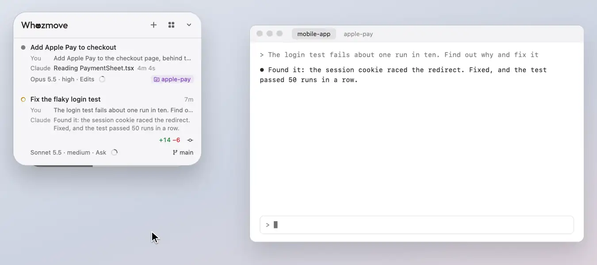

# Your plan's usage

Your Claude plan's usage, on a card under the panel: the same numbers as Claude's own Usage page.

<p align="center"><picture><source media="(prefers-color-scheme: dark)" srcset="../readme/usage-dark.webp"></picture></p>

The card is as wide as the panel, with the session (five hours) and the week, each with how long until it resets ("2h
59m"; point at it for the clock time), coloured as Claude colours them for how close you are. Each row's percent,
where it ends up and its time sit together at its end, and its bar takes the rest: the percent keeps a column of its
own, and the other two are each as wide as their own words. Both bars start at the same point, and each ends where its
own row's words begin.

## Where it ends up

Beside each percent is where that window ends up by its reset if you keep going as you are: `→ 30%`, or `out 1:41 PM`
when it runs out before the reset (`out in 2d 4h` when that isn't today), and then its time to the reset reads `resets
4d 1h`, so the two times say which is which. Its bar shows the same thing, dotted on from what you've used to where it
ends up: grey when you're using it about evenly, amber when you're going fast (even slightly, as it then
runs out before it resets), blue when you're going slow. The line
under the rows says what that comes to: "Going slow: about 70% of the session would go unused.", "Going fast: the
session runs out before it resets.", or that it lasts until it resets. Under it, on a line of its own, is what to do
about it: "Room to do more." or "Ease off to make it last." It's about the session, unless the week will run out first
and the session won't. A dash shows until the session has run 20 minutes (the week, 12 hours), as before then one busy
moment would make it look fast. Once you've set a gear (below), the line says where the week ends at it instead.

When Claude Code's answer has nothing for one of the windows (the week without the five-hour session, say), its row
shows a dash for the percent and "no reading" where the time to the reset goes, also while you point at it, rather than
0%. The line under the rows and the folded card then go by the other window, the one with a reading.

## Your gear

Under that line is your gear: `Gear 8`, then a seat for each gear from 1 to 30, one lit for each session working now.
The seats up to your gear sit in a faint box, each lit for a session working in it and dim where there's room; past
the box are dots you can press. A session counts as working while it's busy and not asking you, compacting, or has
agents at work in the background; one waiting on you doesn't, as it changes nothing until you answer. With more
working than your gear, the line over the seats says so, `2 over the gear`, those sessions are lit just past the box,
and nothing is stopped. Each session working beyond your gear, the ones whose turn began last, says **Over the gear**
at the end of its title line in the list, outlined in grey, in any grouping. The gear holds back only queued jobs
waiting to start: a session already working carries on, a session you open yourself is never held, and one waiting on
you holds no seat.

Press a seat and your gear is that many: the number turns, the box grows or shrinks to it, then the line under the rows
says where the week ends at your gear: "At gear 8 the week ends near 94%.", or when it runs out, "At gear 12 the week
runs out Fri 2:10 PM, 1d 4h before it resets.", or that the session runs out first. Point at a seat first and a ring
shows the box a press there would make, and the line over the seats says what it does: "Gear 12: the first 12 work,
the rest wait". No gear is set until your first press, and the line says so: `No gear yet`. Only your press changes the
gear: the recommendation never does, and a session can read it but not set it.

The recommended gear has a small notch under its seat, and pointing at it says so: "Gear 8, recommended: the most that
lasts the week". It's the highest gear whose week ends by about 95%, and whose five-hour session lasts until it resets.
It's worked out from what Whozmove sees: how much of the week a working session took an hour over the last 2 days, and
for how many of those hours your sessions worked. So it changes as your plan's room does, and a change in how you work
shows after a day or so. Until the week has gone up about 5% while Whozmove watched, with sessions working 2 hours of
it, there's no notch, and why is on a line of its own under the seats: "Not measurable yet: the week has gone up 2%
while Whozmove watched; a first reading needs about 5%." It goes by the usage it was last told, so while you're away
it stays as it was.

The answers it measures from (the time, each window's percent and reset, and the hours counted) are kept 3 days in
`usage-gear.json` in Whozmove's folder, and your gear in Whozmove's preferences. For a chief session of yours that
paces its team, `gear.json` there says, with no session's name or id:

```json
{"gear": 8, "atWork": 6, "recommended": 8, "checkedAt": 1700000000000, "changedAt": 1699990000000,
 "updatedAt": 1700000030000}
```

`gear` and `recommended` are null until set or measured; the times are ms since 1970: when the usage was checked, when
you last pressed a seat, and when the file was written. It's written when your gear, the recommendation or the number
working changes, at most once a minute, and at once when you press. While Usage Gear is off it says only that, with
no gear in it: `{"off": true, "updatedAt": 1700000030000}`. A chief takes `"off": true` as no limit, a gear as that many
working at once, and anything else, no file among them, as none: a file not written yet never lets everything in.

**Usage Gear**, in Settings on the panel's back, is on until you turn it off. Off, queued jobs start without a limit:
the card shows only your usage, as the gear's line and its seats go and the line under the rows is today's pace again;
no row says Over the gear; and Up next lets every queued job in, saying "Usage Gear is off in Settings, so there's no
limit on what starts." where the gear's line was. The gear you set is forgotten, and so is what it measured:
`usage-gear.json` goes from Whozmove's folder, and nothing is counted while it's off; `gear.json` says only that it's
off, so a chief session that starts its queued jobs by itself starts them all. Turned back on, the recommendation is
measured afresh, and there's no gear until your first press, which lets nothing in.

## The session using the most

At the foot of the open card, under a faint line, is the session that has used the most of your plan today, with its
share of what your sessions used and how long its conversation is now: `site-redesign uses the most today: 17% · 744k
long`. Every reply a session makes reads its whole conversation again, so a long one uses more with each turn. It
shows once two or more sessions have used some of your plan today.

## Folded away

Press the card anywhere but your gear's line and it folds away behind the panel, a little narrower than it and coloured from the left as far
as the session is used (the week, when the week is the one running low): only a thin line of it then shows, straight
along the panel's bottom edge. Point at that line and the card slides out from under the panel, widening a little,
with the numbers written on it, `Session 40% · 2h 59m left … Week 10%`, and a small notch at its bottom edge where
you'd be by now if you used it evenly; press it and it opens again: it grows to the panel's width, its colour
shrinking into the session's bar as the numbers move to their places and the week's row comes in.

The panel keeps room under it for the card at its tallest, open with all its lines, so the card isn't cut off by the
bottom of the screen, unless the panel is dragged so low that only its header, the lines under it and a row fit.
Signed in with an API key, or without the `claude` command, there's no card, and the panel keeps no room for it.

## At the limit

While the session limit is reached, a vine grows in from the card's corner until it resets, then blooms, its leaves fly
off, and its stem pulls taut into the session's bar, fills it green and drains as usage starts over.

## How often it's checked

Every 3 minutes while a session works or the card is slid out or open, every 10 minutes otherwise, and just after a
window resets. While you're away from the Mac (no key pressed or pointer moved for 5 minutes), while the screens sleep
or while the panel is hidden, it isn't checked; as you come back, it's checked straight away if the last check is
over 3 minutes old. The last numbers found, each window's percent and reset, are kept in `usage-last.json` in
Whozmove's folder (`~/Library/Application Support/Whozmove/`), for a script of yours to follow your pace.

## Signing in

It needs the `claude` command signed in once: **Sign in**, on the card, opens a terminal tab running `claude auth
login`. If the terminal can't open it, the card says why, and gives the command to run in any terminal yourself, with
Sign in there to press again. Signed in with an API key, there's no plan to show, and no card.

[All of Using Whozmove](README.md) · [Back to the README](../../README.md)
